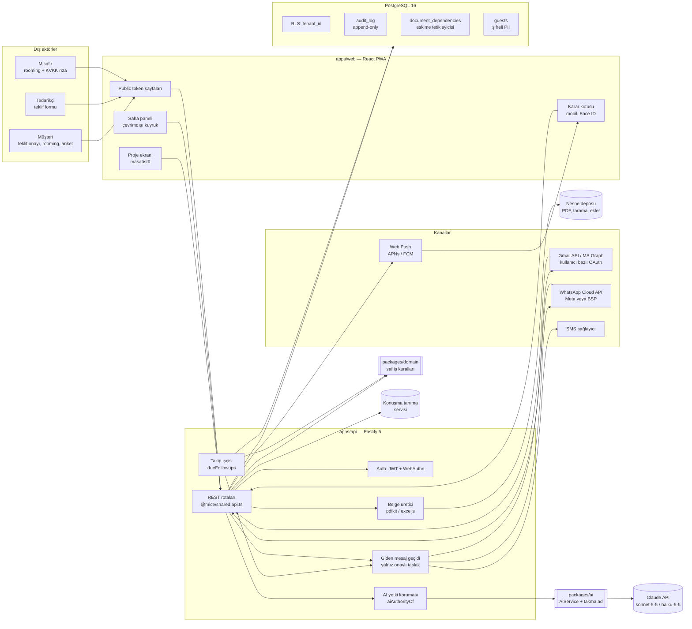

# 01 — Mimari Genel Bakış

> PRD karşılığı: §3 (tasarım ilkeleri), §7 (0–8 iş akışı), §8 (veri merkezi), §11 (teknoloji yaklaşımı).

## 1. Sabit mimari kararları

| Katman | Seçim | Gerekçe |
|---|---|---|
| Repo | npm workspaces TypeScript monorepo | Tek sözleşme (`@mice/shared`), tek tip sistemi; istemci ve sunucu aynı tipleri kullanır |
| Sözleşme | `packages/shared` | Enum, model, API, yapay zekâ yetki listesi ve varsayılan kurallar tek yerde (§3.1) |
| İş kuralları | `packages/domain` | Saf, deterministik, I/O içermeyen fonksiyonlar. Fiyat, marj, fark, takvim ve yetki kuralları birim testlidir |
| Yapay zekâ | `packages/ai` | `AiService` arayüzü. `ClaudeAiService` (`@anthropic-ai/sdk`) ve deterministik `MockAiService`. Modele gitmeden önce kişisel veriye takma ad verilir |
| API | `apps/api` — Fastify 5 | JWT oturum, WebAuthn step-up, zod doğrulama, rate-limit, multipart |
| Veritabanı | PostgreSQL 16 | Acenta bazlı RLS (`SET LOCAL app.tenant_id`), audit tetikleyicileri, silme yasağı tetikleyicileri, belge eskime yayılımı |
| İş kuyruğu | Zamanlanmış takip işçisi (worker) | RFQ hatırlatma, opsiyon alarmı, eskalasyon, KVKK anonimleştirme. `domain.dueFollowups` saf zamanlayıcısını kullanır |
| Belge | pdfkit (PDF), exceljs (Mikro dışa aktarımı, Excel içe aktarımı, rooming list şablonu) | Belgeler her zaman veriden üretilir |
| Web | React 18 + Vite PWA | Mobil karar kutusu, masaüstü proje ekranı, mobil saha paneli, herkese açık token sayfaları |

## 2. Bileşen diyagramı



**Kritik nokta:** Dışarıya giden her mesaj tek bir servisten geçer: **Giden mesaj geçidi** (`OUT`). Bu geçit yalnızca iki tür mesajı gönderir:

- `message_drafts.status = 'approved'` olan ve `approved_by` alanında bir insan kullanıcı bulunan taslak.
- §6'daki tek istisna: onaylı bir RFQ için önceden onaylanmış şablonla gönderilen tedarikçi hatırlatması.

## 3. Çalışma zamanı topolojisi

```
                ┌────────────── CDN / statik (PWA) ──────────────┐
İnternet ──TLS──┤                                                 │
                └── Ters vekil (WAF, rate-limit) ── api (N≥2) ────┼── PostgreSQL 16 (birincil + PITR, ops. bekleme)
                                                    worker (1, lider kilitli)
                                                    │            └── Nesne deposu (şifreli, sürümlü)
                                                    └── Claude API / STT / Gmail-Graph / WhatsApp / SMS (çıkış)
```

- **worker** tek örnek olarak çalışır. Lider seçimi `pg_try_advisory_lock` ile yapılır. Takip eylemleri saf fonksiyonla hesaplanır ve kayda bağlı olarak idempotenttir (`reminder_sent_at`, `alarmed_at` gibi alanlar).
- Her HTTP isteği ve her worker görevi **tek bir veritabanı işlemi (transaction)** içinde çalışır. İşlem başında şu komut çalışır:
  `SELECT set_config('app.tenant_id', $1, true), set_config('app.actor_id', $2, true), set_config('app.actor_type', $3, true), set_config('app.device', $4, true);`
  Üçüncü parametre `true` olduğu için ayar yalnızca o işlem için geçerlidir (`SET LOCAL`). Bağlantı havuzunda acentalar arasında bağlam sızması böyle engellenir.

## 4. 0–8 iş akışında veri akışı

```mermaid
sequenceDiagram
  autonumber
  participant K as Kanal (mail/WA/not/ses)
  participant A as API
  participant AI as AiService
  participant D as Domain
  participant DB as PostgreSQL
  participant KK as Karar kutusu
  participant T as Tedarikçi linki
  participant M as Müşteri linki

  K->>A: Adım 0: inbound_message
  A->>AI: extractRequest (takma adlı metin)
  AI-->>A: RequestExtraction + alan bazlı güven puanı
  A->>D: markLowConfidence, findDuplicates, rfqMinimumMissing, missingFromChecklist, suggestAssignee, formatProjectCode
  A->>DB: projects (+kod), message_drafts(missing_info), decisions(assignment)
  KK-->>A: Atama onayı (admin)
  A->>D: Adım 1: rankSuppliers → kısa liste
  A->>DB: rfqs (draft) + decision(rfq_send)
  KK-->>A: RFQ onayı → Giden geçit: kullanıcının kendi adresinden mail + token linki
  T->>A: Form yanıtı (supplier_offers v1..n) veya mail/PDF/Excel → parseSupplierOffer
  A->>D: Adım 2: normalizeOffer, evaluateOffer (kanal/medyan), canNegotiate
  A->>DB: price_history, offer_evaluations; decision(negotiation_message)
  A->>D: Adım 3: validateQuote, quoteNeedsApproval, profitSummary
  A->>DB: quotes v(n) + documents(quote, pnl) + decision(quote_approval / margin_override)
  KK-->>A: Face ID ile onay → PDF + müşteri onay linki
  M->>A: Adım 4: açıldı / seçenek onayı / revizyon (revisionTargetStep)
  A->>D: Adım 5: parseContract → diffContractVsQuote, conditionRisk
  A->>DB: contracts v(n), decisions(contract_diff, condition_risk, contract_approval)
  KK-->>A: İmza (signatory) → kilit + payable/receivable finance_entries
  A->>D: Adım 6: operationsCalendar → tasks; changeImpact; staleKindsFor
  A->>D: Adım 7: parseInvoice, matchBankTransaction, fieldExtraNeedsAdmin
  A->>DB: finance_entries, bank_transactions, decisions(payment_approval)
  A->>D: Adım 8: closingCheck, supplierScore, suggestChecklistQuestions
  A->>DB: projects.closed_at, price_history (gerçekleşen), checklist (önerilen)
```

### Adım bazında sorumluluk özeti

| Adım | Ana uç noktalar (`api.ts`) | Domain fonksiyonları | AI çağrıları | Onay kapısı (karar türü) |
|---|---|---|---|---|
| 0 Talep | `POST /api/intake` | `rfqMinimumMissing`, `missingFromChecklist`, `findDuplicates`, `markLowConfidence`, `suggestAssignee`, `formatProjectCode`, `businessMinutesBetween` | `extractRequest`, `draftMessage(missing_info)`, `interpretCommand` | `assignment`, `outbound_message` |
| 1 RFQ | `/items/:id/shortlist`, `/items/:id/rfqs`, `/public/rfq/:token` | `rankSuppliers`, `dueFollowups` | `parseSupplierOffer`, `draftMessage(rfq)` | `rfq_send`, `low_confidence_review` |
| 2 Karşılaştırma | `/items/:id/comparison`, `/offers/:id/negotiate`, `/channel-prices` | `normalizeOffer`, `detectHiddenCosts`, `evaluateOffer`, `channelAdvantage`, `markupForAdvantage`, `canNegotiate`, `negotiationDraftViolations` | `draftMessage(negotiation)` | `negotiation_message` |
| 3 Teklif | `POST /projects/:id/quotes`, `/quotes/:id/send` | `validateQuote`, `quoteNeedsApproval`, `profitSummary`, `priceFromCost` | `draftMessage(quote_cover)` | `quote_approval`, `margin_override` |
| 4 Müşteri onayı | `/public/quotes/:token/*`, `/projects/:id/outcome` | `revisionTargetStep`, `dueFollowups` | `draftMessage(quote_followup / option_extension)` | `outbound_message` |
| 5 Sözleşme | `/contracts/:id/parse|compare|sign|amend` | `diffContractVsQuote`, `isContractClean`, `conditionRisk` | `parseContract`, `draftMessage(revision_request / supplier_confirmation)` | `contract_diff`, `condition_risk`, `contract_approval`, `supplier_accreditation` |
| 6 Operasyon | `/tasks`, `/guests`, `/rooming-link`, `/field-extras` | `operationsCalendar`, `changeImpact`, `staleKindsFor`, `fieldExtraNeedsAdmin` | `draftMessage(daily_summary)` | `field_extra`, `margin_override` |
| 7 Finans | `/finance/*` | `matchBankTransaction`, `parseBankCsv`, `dueFollowups` | `parseInvoice` | `payment_approval`, `unbilled_payment_escalation`, `low_confidence_review` |
| 8 Kapanış | `/closing-check`, `/close`, `/public/survey` | `closingCheck`, `supplierScore` | `suggestChecklistQuestions`, `summarizeStyle` | `checklist_question`, `low_supplier_score`, `closing_overdue`, `rule_suggestion` |

## 5. §3 tasarım ilkelerinin teknik uygulanışı

| # | İlke | Teknik mekanizma | Nerede |
|---|---|---|---|
| 1 | **Tek doğru kaynak** | Belgeler (`documents`) yalnızca `content` JSON'unu ve hangi varlık sürümlerinden üretildiğini saklar. PDF her seferinde bu veriden render edilir. Elle düzenlenebilir belge alanı yoktur. Para birimi ve kur, teklif satırında `fx_rate/fx_source/fx_date` olarak bir kez tutulur. | `documents`, `document_dependencies`, `@mice/shared` tipleri |
| 2 | **Onay kapıları** | Kritik geçişler veritabanında **durum makinesi** olarak tanımlıdır (`quotes.status`, `contracts.status`, `finance_entries.status`). `pending_approval → approved` geçişi yalnızca `decisions` kaydı üzerinden yapılabilir. Tetikleyici, geçişte `app.actor_type = 'user'` olduğunu ve ilgili karar kaydının bulunduğunu doğrular. Önce domain kuralları (`validateQuote` vb.) çalışır; kural dışı durumda kayıt `blocked` olur ve onaya gelmeden önce ekibe döner. | `decisions`, `domain/quote-validation`, `domain/authority` |
| 3 | **İnsan imzası** | AI katmanı yalnızca `MessageDraft` üretir. Gönderim yalnızca Giden mesaj geçidinden yapılır. Geçit sorumlu kullanıcının OAuth bağlantısıyla, **kullanıcının kendi posta kutusundan** gönderir; mesaj kullanıcının "Gönderilmiş" klasöründe görünür. Taslaklar `styleExamples` ile sahibin üslubunda yazılır. | `packages/ai`, `message_drafts`, `mail_accounts` |
| 4 | **Kısa ve net** | Taslak istemlerinde uzunluk sınırı vardır (ör. RFQ ≤ 120 kelime). Taslak üretiminden sonra kelime sayısı kontrol edilir. | `ClaudeAiService.draftMessage` |
| 5 | **Değişiklik yayılımı** | Kaynak tablolardaki `AFTER UPDATE` tetikleyicisi, bağımlı belgeleri `status='stale'` ve `stale_reason` ile işaretler. `/send` uç noktaları belge `current` değilse 409 döner. Statik harita `DOCUMENT_DEPENDENCIES` arayüzde etki tahmini için kullanılır. | `02-veri-modeli.md §6`, `domain/propagation` |
| 6 | **Silinmez kayıt** | Tüm iş tablolarında `BEFORE DELETE` tetikleyicisi istisna fırlatır. Uygulama rolünün `DELETE` yetkisi de geri alınır. Her `INSERT/UPDATE` işlemi genel audit tetikleyicisi ile `audit_log` tablosuna yazılır: kim, ne zaman, hangi cihaz, önce/sonra. `audit_log` yalnızca eklemeye açıktır (append-only). Yanlış kayıt silinmez; `cancelled`/`passive`/`superseded` durumuna alınır. | `02-veri-modeli.md §5` |
| 7 | **Belirsizlikte dürüstlük** | Domain fonksiyonları veri yokken `null` / `'unknown'` döner (`evaluateOffer`, `median`). AI çıktısının her alanında güven puanı (`Extracted<T>`) bulunur. Eşik altındaki alanlar `needsReview` olur ve `low_confidence_review` kartı açılır. `ask()` yalnızca verilen olgulardan cevap verir, aksi halde "veri yok" der. Arayüzde "geçmiş veri yok" rozeti gösterilir. | `domain/evaluation`, `AiService.ask` |
| 8 | **Çok kiracılılık** | Her tabloda `tenant_id NOT NULL` bulunur. `ENABLE` ve `FORCE ROW LEVEL SECURITY` açıktır. Uygulama rolü sahip (owner) değildir ve `BYPASSRLS` yetkisi yoktur. Kurallar `rules` tablosunda acenta bazında tutulur; eksik anahtar için `DEFAULT_RULES` kullanılır. CI'da katalog testi, RLS'siz tablo bulursa derlemeyi kırar. | `02-veri-modeli.md §3–4` |

### §6 yapay zekâ yetki sınırının uygulanması (savunma katmanları)

1. **Kapalı liste:** `aiAuthorityOf(action)` listede olmayan işlem için `'forbidden'` döner.
2. **Arayüz yüzeyi:** `AiService` yalnızca okuma, ayıklama ve taslak üretir. Gönderme, ödeme veya imza metodu yoktur.
3. **API koruması:** AI aktörüyle (`actor_type='ai'`) çalışan kod yolları her çağrıda `assertAiAction(action)` çağırır ve sonucu `ai_actions` tablosuna kaydeder.
4. **Veritabanı:** Ödeme onayı, imza, akreditasyon ve kural değişikliği tetikleyicileri `actor_type <> 'user'` olduğunda reddeder.
5. **Giden geçit:** İnsan onayı olmayan mesaj fiziksel olarak gönderilemez. Tek istisna kodda adıyla tanımlıdır (`supplier_rfq_reminder`) ve onaylı şablon sürümüne bağlıdır.

## 6. Kesişen konular

| Konu | Yaklaşım |
|---|---|
| Kimlik doğrulama | E-posta + parola (argon2id) veya Google/Microsoft SSO. JWT kısa ömürlüdür (15 dk) ve rotasyonlu yenileme belirteci kullanılır. Para ve sözleşme kararında WebAuthn step-up zorunludur (`requiresBiometric`). |
| Herkese açık sayfalar | `/api/public/*`. 256-bit token'ın yalnızca SHA-256 özeti saklanır. Token tek kaynağa bağlıdır ve süre sınırı vardır (bkz. 07 §10). |
| Gözlemlenebilirlik | Yapılandırılmış log (pino) içinde PII bulunmaz. Her isteğe `request_id` atanır. AI çağrılarında model, token, gecikme ve güven puanı `ai_actions` tablosuna yazılır. |
| Zaman | Saklama UTC'dir. İş takvimi `Europe/Istanbul` (`rules.businessHours`) ve resmi tatiller tablosuna göre hesaplanır. |
| Para | Tutarlar `numeric(14,2)` tipindedir. İç hesap EUR'dur. Kur kaynağı ve tarihi kaydedilir (ör. TCMB döviz satış kuru; kaynak acentaya göre seçilir). |
| Dil | Arayüz TR. Yazışmalar TR, EN ve RU (`Language`). |
| Gizli anahtarlar | Ortam değişkeni ve gizli anahtar yöneticisinde tutulur. OAuth yenileme belirteçleri uygulama düzeyinde zarf şifrelemeyle (envelope encryption) saklanır. |
