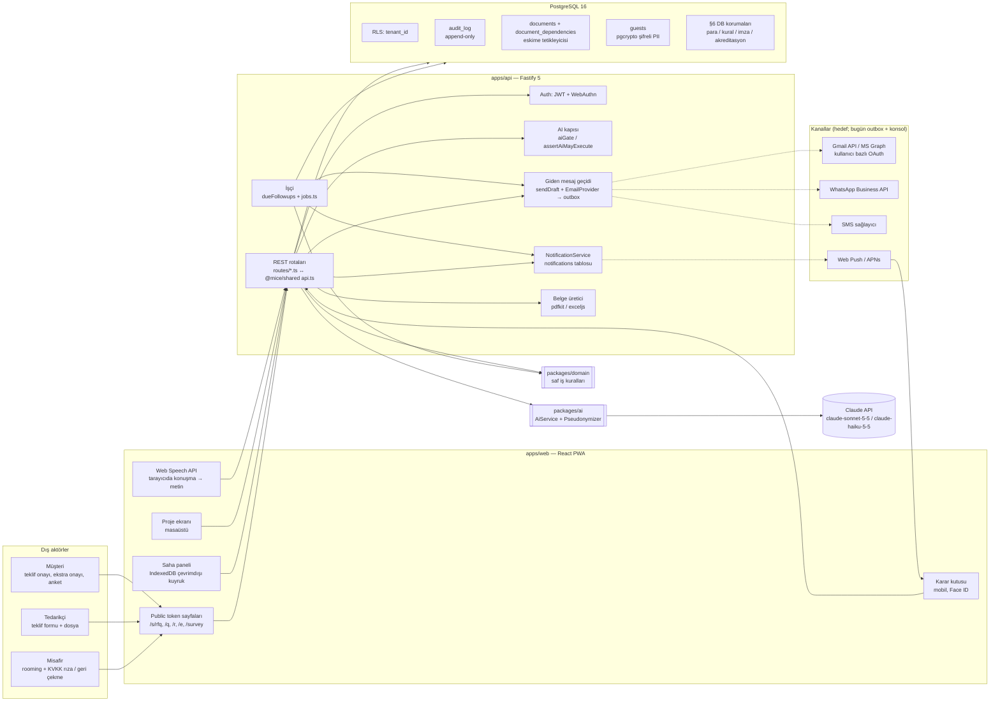

# 01 — Mimari Genel Bakış

> PRD karşılığı: §3 (tasarım ilkeleri), §7 (0–8 iş akışı), §8 (veri merkezi), §11 (teknoloji yaklaşımı).
> Kod karşılığı: `apps/api/src/routes/*` (rota kayıt indeksi `routes/index.ts`), `apps/api/src/services/*`, `apps/api/src/db/migrations/*.sql`, `packages/*`. Gerçek rota listesi ve sözleşmeden sapmalar: [`apps/api/README.md`](../apps/api/README.md).

## 1. Sabit mimari kararları

| Katman | Seçim | Gerekçe / uygulanış |
|---|---|---|
| Repo | npm workspaces TypeScript monorepo | Tek sözleşme (`@mice/shared`), tek tip sistemi; istemci ve sunucu aynı tipleri kullanır |
| Sözleşme | `packages/shared` | Enum, model, API (`api.ts`, sonradan eklenen "ADDITIVE" bölümleri dahil), yapay zekâ yetki listesi (`ai-authority.ts`) ve varsayılan kurallar (`rules.ts`) tek yerde (§3.1) |
| İş kuralları | `packages/domain` | Saf, deterministik, I/O içermeyen fonksiyonlar. Fiyat, marj, fark, takvim, KVKK saklama ve yetki kuralları birim testlidir |
| Yapay zekâ | `packages/ai` | `AiService` arayüzü. `ClaudeAiService` (`@anthropic-ai/sdk`) ve deterministik `MockAiService`; seçim `createAiService()` (`factory.ts`) ile: `ANTHROPIC_API_KEY` yoksa veya `AI_PROVIDER=mock` ise mock. Modeller `AI_MODEL` (varsayılan `claude-sonnet-5-5`) ve `AI_MODEL_FAST` (varsayılan `claude-haiku-5-5`, yalnız sesli komut niyeti). Metin modele gitmeden önce `Pseudonymizer` (`pii.ts`) ile maskelenir; sınırları için bkz. 07 §2 |
| API | `apps/api` — Fastify 5 | JWT oturum (`JWT_EXPIRES_IN`, varsayılan 12 saat), WebAuthn step-up, zod doğrulama, `/api/public/*` için IP bazlı rate-limit (`PUBLIC_RATE_LIMIT`), multipart yükleme |
| Veritabanı | PostgreSQL 16 | Acenta bazlı RLS (`tenant_id = app_tenant_id()`, `SET LOCAL app.tenant_id`), audit tetikleyicisi, silme yasağı tetikleyicileri, belge eskime yayılımı ve §6 için DB korumaları (bkz. §5.1) |
| İş kuyruğu | Zamanlanmış işçi (`src/worker.ts` `runFollowupsOnce`, `src/jobs.ts`) | RFQ hatırlatma (24 sa) ve arama görevi (48 sa), teklif takibi taslağı, opsiyon alarmı + uzatma taslağı, ödenmemiş ödeme eskalasyonu, kapanış gecikmesi; Faz B işleri: etkinlik bitiş işareti, KVKK anonimleştirme, bildirim özetleri, günlük özet taslakları. `domain.dueFollowups` saf zamanlayıcısını kullanır; aralık `WORKER_INTERVAL_MS` |
| Belge | pdfkit (PDF), exceljs | Belgeler her zaman veriden üretilir. exceljs: Mikro dışa aktarımı, tedarikçi Excel teklifinin CSV'ye çevrilmesi (modele tablo olarak gider), banka ekstresi XLSX içe aktarımı, standart rooming list şablonu (dışa aktarım) |
| Dosya saklama | PostgreSQL `bytea` (`documents.file_data`, `offer_files.data`) | Ayrı nesne deposu **henüz yok**; üretim için şifreli, sürümlü nesne deposu önerilir [Ürün kararı] |
| Web | React 18 + Vite PWA | Mobil karar kutusu, masaüstü proje ekranı, mobil saha paneli (IndexedDB çevrimdışı kuyruk, `lib/offlineQueue.ts`), herkese açık token sayfaları; sesli not tarayıcının Web Speech API'siyle metne çevrilir (`lib/speech.ts`) |

## 2. Bileşen diyagramı

Diyagram hedef mimariyi gösterir. Kesik çizgili kutular (`Kanallar`) **henüz gerçek sağlayıcıya bağlı değildir**: bugün tüm dış mesajlar `outbox` tablosuna yazılır (+ geliştirmede konsol), push bildirimleri `notifications` tablosuna yazılıp konsol uygulamasıyla "teslim edilir". Uygulama durumu için bkz. [README "Uygulama durumu"](README.md#uygulama-durumu).



**Kritik nokta:** Dışarıya giden her mesaj tek bir yoldan geçer: **Giden mesaj geçidi** — `services/drafts.ts` `sendDraft()` → `EmailProvider.send()` (`services/email.ts`; bugünkü uygulama `OutboxEmailProvider`, gerçek SMTP/Graph yok). Geçit şunları gönderir:

- `message_drafts` taslağı; `requires_approval=true` ise yalnızca `status='approved'` olduktan sonra (onay bir karar kartından gelir: `rfq_send`, `negotiation_message`, `outbound_message`, `contract_diff` …). Gönderim, sorumlu insan kullanıcının adresinden (`from_address`) yapılır. Fiyat içermeyen eksik bilgi sorusu (`missing_info`) `requires_approval=false` olarak açılır; clerk kendisi gönderir (`POST /api/drafts/:id/send`) veya `POST /api/drafts/:id/request-approval` ile onaya yollar.
- §6'daki tek istisna: işçinin `supplier_reminder` eylemi. Metin AI tarafından üretilmez; kodda sabit, dil bazlı şablondur (`worker.ts` `RFQ_REMINDER_TEMPLATE`), yeni link içermez, `outbox.autonomous=true` olarak işaretlenir ve `ai_actions`'a `supplier_rfq_reminder` olarak yazılır. RFQ'nun `sent` olması (yani insan onaylı `rfq_send`) ön koşuldur.
- Herkese açık tek kullanımlık linkler (token) mesaj gövdesine gönderim anında eklenir ve outbox kopyasında `[gizli-bağlantı]` olarak maskelenir (`redact`).

## 3. Çalışma zamanı topolojisi

```
                ┌────────────── CDN / statik (PWA) ──────────────┐
İnternet ──TLS──┤                                                 │
                └── Ters vekil (WAF, rate-limit) ── api (N≥2) ────┼── PostgreSQL 16 (birincil + PITR, ops. bekleme)
                                                    worker (1)    │
                                                    └── Claude API (çıkış); hedef: Gmail-Graph / WhatsApp / SMS / Push
```

- Üretim kurulumu (konteyner imajları, CI) ayrı bir çalışmayla ekleniyor; bkz. üretim hazırlığı dokümanları (Docker/CI). Güvenlik incelemesi için bkz. [09-guvenlik-incelemesi.md](09-guvenlik-incelemesi.md).
- **worker** tek örnek olarak çalıştırılmalıdır. Takip eylemleri saf fonksiyonla hesaplanır ve kayda bağlı olarak idempotenttir (`reminder_sent_at`, `call_task_created_at`, `alarmed_at`, `escalated_at`, görevlerde `UNIQUE (tenant_id, origin_key)`). İşçi kopyaları arasında **lider kilidi (`pg_try_advisory_lock`) henüz yoktur**; yalnızca migration aracı advisory lock kullanır (`db/migrate.ts`). Birden fazla işçi örneği gerekirse eklenmelidir [Doğrulanmalı].
- Her HTTP isteği ve her işçi görevi **tek bir veritabanı işlemi (transaction)** içinde çalışır (`withTenant()`, `src/db/pool.ts`). İşlem başında şu komut çalışır:
  `SELECT set_config('app.tenant_id', $1, true), set_config('app.user_id', $2, true), set_config('app.actor_type', $3, true), set_config('app.device', $4, true);`
  Üçüncü parametre `true` olduğu için ayar yalnızca o işlem için geçerlidir (`SET LOCAL`). Bağlantı havuzunda acentalar arasında bağlam sızması böyle engellenir. AI otomatik yürütmesi sırasında aktör `setActor()` ile geçici olarak `actor_type='ai'` yapılır; DB korumaları bu değeri okur.
- İşçi acentaları `app_tenant_ids()` (SECURITY DEFINER) ile listeler ve her acentayı ayrı `withTenant()` işleminde işler. Giriş `auth_lookup_user()`, public token rotaları `resolve_public_token()` ile acentayı bulur; sonrası RLS altında çalışır.

## 4. 0–8 iş akışında veri akışı

```mermaid
sequenceDiagram
  autonumber
  participant K as Kanal (yapıştırılan mail/WA/not/ses)
  participant A as API
  participant AI as AiService
  participant D as Domain
  participant DB as PostgreSQL
  participant KK as Karar kutusu
  participant T as Tedarikçi linki
  participant M as Müşteri linki

  K->>A: Adım 0: POST /api/intake → inbound_messages
  A->>AI: extractRequest (maskelenmiş metin)
  AI-->>A: RequestExtraction + alan bazlı güven puanı
  A->>D: markLowConfidence, findDuplicates, rfqMinimumMissing, missingFromChecklist, suggestAssignee, formatProjectCode
  A->>DB: projects (+kod), message_drafts(missing_info), decisions(assignment)
  KK-->>A: Atama onayı (admin)
  A->>D: Adım 1: rankSuppliers → kısa liste
  A->>DB: rfqs (draft) + decision(rfq_send)
  KK-->>A: RFQ onayı → Giden geçit: kullanıcının adresinden mail + tek kullanımlık token linki
  T->>A: Form yanıtı (supplier_offers v1..n) veya dosya (/files) / yapıştırılan mail → parseSupplierOffer
  A->>D: Adım 2: normalizeOffer, evaluateOffer (kanal/medyan), canNegotiate, negotiationDraftViolations
  A->>DB: supplier_offers, negotiation_rounds; decision(negotiation_message)
  A->>D: Adım 3: validateQuote, quoteNeedsApproval, profitSummary
  A->>DB: quotes v(n) + quote_lines + documents(quote, pnl) + decision(quote_approval / margin_override)
  KK-->>A: Face ID ile onay → POST /api/quotes/:id/send → PDF + müşteri onay linki
  M->>A: Adım 4: açıldı / seçenek kabulü / revizyon (extractRequest + revisionTargetStep)
  A->>D: Adım 5: parseContract → diffContractVsQuote, isContractClean, conditionRisk
  A->>DB: contracts v(n), decisions(contract_diff, condition_risk, contract_approval)
  KK-->>A: İmza (can_sign / signatory) → kilit + payable/receivable finance_entries + reservations + konfirmasyon taslağı
  A->>D: Adım 6: operationsCalendar → tasks; changeImpact; fieldExtraNeedsAdmin
  A->>D: Adım 7: parseInvoice, parseBankCsv, matchBankTransaction
  A->>DB: finance_entries, bank_transactions, decisions(payment_approval, low_confidence_review)
  A->>D: Adım 8: closingCheck, supplierScore
  A->>AI: suggestChecklistQuestions (+ summarizeStyle haftalık raporda)
  A->>DB: projects.closed_at, price_history (realized), checklist_questions (suggested), surveys
```

### Adım bazında sorumluluk özeti

Tüm uç noktalar `/api` önekiyle; tam liste `apps/api/src/routes/*.ts`.

| Adım | Ana uç noktalar | Domain fonksiyonları | AI çağrıları (`AiService`) | Onay kapısı (karar türü) |
|---|---|---|---|---|
| 0 Talep | `POST /api/intake`, `POST /api/assist/voice-command`, `POST /api/drafts/:id/send` | `rfqMinimumMissing`, `missingFromChecklist`, `findDuplicates`, `markLowConfidence`, `suggestAssignee`, `formatProjectCode`, `businessMinutesBetween` | `extractRequest`, `draftMessage(missing_info)`, `interpretCommand` (hızlı model) | `assignment`; eksik bilgi sorusu onaysız (clerk gönderir) veya `outbound_message` |
| 1 RFQ | `GET /api/items/:id/shortlist`, `POST /api/items/:id/rfqs`, `POST /api/rfqs/:id/link`, `POST /api/rfqs/:id/cancel`, `GET/POST /api/public/rfq/:token`, `POST /api/public/rfq/:token/files` | `rankSuppliers`, `dueFollowups` | `parseSupplierOffer`, `draftMessage(rfq)` | `rfq_send`, `low_confidence_review` |
| 2 Karşılaştırma | `POST /api/items/:id/offers`, `POST /api/items/:id/offers/parse`, `POST /api/offers/:id/verify`, `GET /api/items/:id/comparison`, `POST /api/offers/:id/negotiate`, `POST /api/channel-prices`, `POST /api/items/:id/select-offer` | `normalizeOffer` (içinde `detectHiddenCosts`, `toEur`), `evaluateOffer` (içinde `channelAdvantage`, `median`), `markupForAdvantage`, `canNegotiate`, `negotiationDraftViolations` | `draftMessage(negotiation)` | `negotiation_message` |
| 3 Teklif | `POST /api/projects/:id/quotes`, `GET /api/projects/:id/quotes`, `POST /api/quotes/:id/send`, `GET /api/quotes/:id/pdf` | `validateQuote`, `quoteNeedsApproval`, `profitSummary` | `draftMessage(quote_cover)` | `quote_approval`, `margin_override` |
| 4 Müşteri onayı | `GET /api/public/quotes/:token`, `POST …/accept`, `POST …/revision`, `POST /api/quotes/:id/firm-approval`, `POST /api/projects/:id/outcome` | `revisionTargetStep`, `dueFollowups` | `extractRequest` (revizyon farkı), `draftMessage(quote_followup / option_extension)` | `outbound_message` |
| 5 Sözleşme | `POST /api/projects/:id/contracts`, `POST /api/contracts/:id/parse`, `…/compare`, `…/sign`, `…/amend`, `PATCH /api/suppliers/:id` | `diffContractVsQuote`, `isContractClean`, `conditionRisk` | `parseContract`, `draftMessage(revision_request / supplier_confirmation)` | `contract_diff`, `condition_risk`, `contract_approval`, `supplier_accreditation` |
| 6 Operasyon | `GET /api/tasks`, `POST /api/tasks/:id/complete`, `GET/POST /api/projects/:id/guests`, `POST /api/projects/:id/rooming-link`, `GET /api/projects/:id/rooming-list.xlsx`, `…/field-extras`, `…/field-issues`, `GET /api/projects/:id/daily-summary`, `PATCH /api/items/:id`, `/api/public/rooming|extras|consent/:token` | `operationsCalendar`, `changeImpact`, `fieldExtraNeedsAdmin`, `retentionUntil`, `shouldAnonymize` | `draftMessage(daily_summary)` | `field_extra`; değişiklik akışında marj hedef altına düşerse `condition_risk` |
| 7 Finans | `/api/finance/*` (faturalar, ödeme talepleri, `entries/:id/mark-paid`, banka ekstresi, eşleştirme, komisyon, müşteri faturası no, `export/mikro`), `POST /api/projects/:id/customer-invoice-draft` | `parseBankCsv`, `matchBankTransaction`, `dueFollowups` | `parseInvoice` | `payment_approval`, `unbilled_payment_escalation`, `low_confidence_review` |
| 8 Kapanış | `GET /api/projects/:id/closing-check`, `POST /api/projects/:id/close`, `GET/POST /api/public/survey/:token`, `GET /api/reports/weekly` | `closingCheck`, `supplierScore` | `suggestChecklistQuestions`, `summarizeStyle` | `checklist_question`, `low_supplier_score`, `closing_overdue`; `rule_suggestion` kart türü ve etkisi var, öneri üreticisi henüz yok |

> Not: `priceFromCost` ve `staleKindsFor` domain'de birim testli yardımcılardır ancak API tarafından çağrılmaz. Alan bazlı eskime filtresi veritabanı tetikleyicisinin izlenen sütun listesiyle yapılır (bkz. 02 §6).

## 5. §3 tasarım ilkelerinin teknik uygulanışı

| # | İlke | Teknik mekanizma | Nerede |
|---|---|---|---|
| 1 | **Tek doğru kaynak** | Belgeler (`documents`) `content` JSON'unu, üretilen dosyayı (`file_data`) ve hangi varlıklardan üretildiğini (`document_dependencies`) saklar. Elle düzenlenebilir belge alanı yoktur; değişiklik "yeniden üret" (`POST /api/documents/:id/regenerate`) ile yeni sürüm demektir. Üreticiler `registerDocumentGenerator(kind, …)` ile kayıtlıdır (`services/documents.ts`, `documents-b.ts`). Kur, teklifte `fx_rate/fx_source/fx_date` olarak bir kez tutulur (`fx_rates` tablosundan). | `documents`, `document_dependencies`, `@mice/shared` tipleri |
| 2 | **Onay kapıları** | Kritik geçişler durum alanlarıyla (`quotes.status`, `contracts.status`, `finance_entries.status`) ve karar kartlarıyla (`decisions`) yönetilir. Kararın etkisi `registerDecisionEffect(kind, fn)` ile kayıtlı fonksiyondur (`services/registry.ts`, `phase-b-registry.ts`). Önce domain kuralları (`validateQuote` vb.) çalışır; kural dışı teklif `blocked` olur ve onaya gelmeden önce ekibe döner. Veritabanı ayrıca şunları zorlar: `approved` teklifte `approved_by` veya `approval_decision_id` (CHECK); onaysız teklif `sent` olamaz (`quotes_send_guard`); kilitli sözleşme yalnızca ek protokolle değişir (`contract_lock`); para ve imza geçişleri yalnızca insan aktörle (bkz. §5.1). | `decisions`, `domain/quote-validation`, `domain/authority`, `003_security_and_integrity.sql`, `004_phase_b.sql` |
| 3 | **İnsan imzası** | AI katmanı yalnızca `Draft` üretir. Gönderim yalnızca Giden mesaj geçidinden yapılır ve kullanıcının kendi adresinden çıkar (bugün `outbox`; hedef Gmail/Graph "send as user"). Taslaklar sahibin düzeltmelerinden çıkarılan `styleExamples` (`original_body` → `body`) ile üslup öğrenir. | `packages/ai`, `services/drafts.ts`, `services/email.ts`, `message_drafts`, `outbox` |
| 4 | **Kısa ve net** | Taslak istemi "selam + 1–4 kısa cümle veya kısa madde listesi + kapanış" kuralını taşır (`prompts.ts` `SYSTEM_DRAFT`). Rakip adı/fiyatı taslak girdisinden ayıklanır (`sanitizeDraftFacts`); kendini AI olarak ele veren taslak düşük güvenle işaretlenir (`revealsAi`). Üretim sonrası ayrı kelime sayısı kontrolü yoktur. | `packages/ai/src/prompts.ts`, `drafts.ts` |
| 5 | **Değişiklik yayılımı** | Kaynak tablolardaki `AFTER INSERT/UPDATE` tetikleyicisi (`propagate_staleness`, yalnızca izlenen sütunlar değişince) bağımlı belgeleri `status='stale'` ve `stale_reason` ile işaretler; `doc_kinds_for()` domain'deki `DOCUMENT_DEPENDENCIES` haritasının aynasıdır (test eşitliği doğrular). Eski belge gönderilemez (`documents_send_guard`), teklif belgesi `current` değilse teklif `sent` olamaz (`quotes_send_guard`) → `409 DOCUMENT_STALE`. | `02-veri-modeli.md §6`, `domain/propagation` |
| 6 | **Silinmez kayıt** | Tüm kiracılı tablolarda `BEFORE DELETE` ve `BEFORE TRUNCATE` tetikleyicisi istisna fırlatır (`forbid_delete`); `mice_app` rolünün `DELETE` yetkisi de yoktur. Her `INSERT/UPDATE` genel `audit_row()` tetikleyicisiyle `audit_log` tablosuna yazılır: aktör tipi ve kimliği, zaman, cihaz, proje, önce/sonra (gizli ve şifreli alanlar `audit_redact` ile çıkarılır). `audit_log` yalnızca eklemeye açıktır. Yanlış kayıt silinmez; `cancelled`/`passive`/`superseded`/`ended` durumuna alınır. | `02-veri-modeli.md §5` |
| 7 | **Belirsizlikte dürüstlük** | Domain fonksiyonları veri yokken `null` / `'unknown'` döner (`evaluateOffer`, `median`). AI çıktısının her alanında güven puanı (`Extracted<T>`, `fieldConfidence`) bulunur. `aiConfidenceThreshold` altındaki alanlar `low_confidence_review` kartına düşer. `ask()` yalnızca verilen olgulardan cevap verir, aksi halde "Bu konuda veri yok." der. Arayüzde "geçmiş veri yok" rozeti gösterilir. | `domain/evaluation`, `AiService.ask` |
| 8 | **Çok kiracılılık** | Her tabloda `tenant_id NOT NULL` bulunur (`tenants` tablosunda `tenant_id` = `id` üretilmiş sütun). `ENABLE` ve `FORCE ROW LEVEL SECURITY` açıktır; politika `tenant_isolation`. `apply_standard_policies(tablo)` yeni tablolara RLS + silme yasağı + audit + yetkileri tek çağrıda uygular. Uygulama rolü `mice_app` sahip değildir, `NOSUPERUSER NOBYPASSRLS`. Kurallar `rules` tablosunda acenta bazında tutulur; eksik anahtar için `DEFAULT_RULES` kullanılır. Katalog testi RLS'siz tablo bulursa test kırılır. | `02-veri-modeli.md §3–4`, `apps/api/test/security.test.ts` |

### 5.1 §6 yapay zekâ yetki sınırının uygulanması (savunma katmanları)

1. **Kapalı liste:** `aiAuthorityOf(action)` (`@mice/shared/ai-authority.ts`) listede olmayan işlem için `'forbidden'` döner.
2. **Arayüz yüzeyi:** `AiService` yalnızca okuma, ayıklama ve taslak üretir. Gönderme, ödeme, imza, akreditasyon veya kural yazma metodu yoktur. `@mice/ai` ayrıca `assertAiMayPerform(action, mode)` korumasını sağlar.
3. **API koruması:** Öneri türü her AI işlemi tek giriş noktası `aiGate(ctx, actionType, spec)` (`services/automation.ts`) üzerinden karar kartına döner; terfi edilmiş (`auto`) bir sayaçta bile `NEVER_AUTO_KINDS` (para, sözleşme, akreditasyon, kural, saha ekstrası, otomasyonun kendisi …) otomatik yürütülmez. Yasak işlemler `assertAiMayExecute()` ile `403 AI_FORBIDDEN_ACTION` döner (örn. `signContract` AI aktörüyle çağrılırsa). Her AI çağrısı `logAiAction()` ile `ai_actions` tablosuna yazılır (model, güven, token, mod, bağlı karar).
4. **Veritabanı korumaları** (`app_actor_type()` okunarak; ihlalde `MI006` → `403 FORBIDDEN_FOR_ACTOR`):
   - `finance_money_guard` — `finance_entries.status` `approved`/`paid` geçişi yalnızca `actor_type='user'` ile (§6 `money_movement`).
   - `rules_change_guard` — `actor_type='ai'` iken `rules` tablosuna hiçbir `INSERT/UPDATE` yapılamaz (§6 `rule_change`).
   - `supplier_accreditation_guard` — AI (ve tedarikçi/müşteri) aktörü tedarikçiyi `accredited` yapamaz; ayrıca CHECK: `accredited` ⇒ `accredited_by` dolu.
   - `contract_sign_guard` — `contracts.status → signed` yalnızca `actor_type='user'` ile.
   - `contract_lock` — imzalı (`locked`) sözleşmede yalnızca `signed → amended` ve `superseded_by` değişebilir (`MI002`).
   - `documents_send_guard` / `quotes_send_guard` — eski (stale) belge gönderilemez; onaysız veya belgesi güncel olmayan teklif `sent` olamaz (`MI003`/`MI005`).
   - Rol kontrolleri (yalnızca admin akredite eder, `can_sign` imzalar, yalnızca admin kural/yetki değiştirir) **uygulama katmanındadır** (`roleCan`, `canDecide`, rota korumaları); DB korumaları aktör tipini denetler.
5. **Giden geçit:** İnsan onayı gerektiren taslak onaylanmadan gönderilemez (`DRAFT_NOT_APPROVED`). Tek otonom istisna adıyla tanımlıdır (`supplier_rfq_reminder`) ve koddaki sabit şablona bağlıdır.

## 6. Kesişen konular

| Konu | Yaklaşım |
|---|---|
| Kimlik doğrulama | E-posta + parola (Node `scrypt`, `lib/crypto.ts`). JWT ömrü `JWT_EXPIRES_IN` (varsayılan 12 saat); yenileme belirteci ve Google/Microsoft SSO **henüz yok** [Ürün kararı]. Para, sözleşme ve müşteri teklifi kararlarında WebAuthn step-up zorunludur (`requiresBiometric`: `payment_approval`, `contract_approval`, `field_extra`, `quote_approval`, `margin_override`). Geliştirme doğrulaması (`{biometric:{method:'dev'}}`) yalnızca `NODE_ENV!=='production'` veya `ALLOW_DEV_BIOMETRIC=1` iken kabul edilir. |
| Herkese açık sayfalar | `/api/public/*`. 32 bayt rastgele token'ın yalnızca SHA-256 özeti (hex) saklanır: `rfqs.token_hash`, `quotes.public_token_hash`, `surveys.token_hash`, diğerleri `public_tokens` (`rooming`, `extra`, `survey`, `consent`). Token tek kaynağa bağlıdır, süre/salt-okunur sınırı ve iptal alanı vardır (bkz. 07 §10). Kendi rate-limit kapsamı vardır. |
| Gözlemlenebilirlik | Fastify'ın yerleşik (pino) logger'ı geliştirmede açıktır. AI çağrılarında model, token (`tokens` jsonb: input/output/cacheRead/cacheWrite), güven puanı ve mod `ai_actions` tablosuna yazılır. Gecikme ve maliyet alanı henüz yoktur. |
| Zaman | Saklama UTC'dir. İş takvimi `rules.businessHours` (varsayılan `Europe/Istanbul`, 09:00–18:00, hafta içi, `holidays[]` listesi) ile hesaplanır; ayrı tatil tablosu yoktur. |
| Para | Tutarlar `numeric(14,2)` tipindedir. İç hesap EUR'dur. Kur `fx_rates` tablosundan, kaynağı ve tarihiyle okunur; otomatik kur çekme (ör. TCMB) **henüz yok**. |
| Dil | Arayüz TR. Yazışmalar TR, EN ve RU (`Language`). |
| Gizli anahtarlar | Ortam değişkenleri (`.env.example`). `GUEST_DATA_KEY` misafir PII'sinin pgcrypto anahtarıdır ve veritabanında saklanmaz. OAuth posta kutusu bağlantısı henüz olmadığından yenileme belirteci saklanmaz. |
