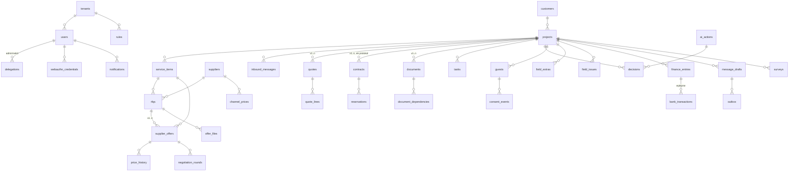

# 02 — Veri Modeli (§19.1)

> PRD karşılığı: §5 (proje/kalem), §8 (veri merkezi, 8 blok), §19.1 (veri modeli), §18.11 (izolasyon testi), §18.13 (değişiklik yayılımı), §18.15 (rıza).
> Kod karşılığı: `apps/api/src/db/migrations/001_foundation.sql` (rol, bağlam fonksiyonları), `002_tables.sql` (tüm tablolar), `003_security_and_integrity.sql` (RLS, audit, silme yasağı, eskime, kilitler, korumalar), `004_phase_b.sql` (bildirimler, üslup özetleri, ödeme/ekstra sütunları, para ve kural korumaları), `006_delivery_channels.sql` (SMTP teslim durumu, `outbox_payloads`, `push_subscriptions`), `007_security_review.sql` (güvenlik incelemesi sertleştirmeleri; bkz. 09). API şekilleri `packages/shared/src/models.ts` (API'de camelCase; veritabanında snake_case).
> Yeni tablo eklemek: yeni migration'da tabloyu oluşturup `SELECT apply_standard_policies('tablo')` çağırın (RLS + silme yasağı + audit + yetkiler).

## 1. Genel kurallar

| Kural | Uygulama |
|---|---|
| Kimlik | `id uuid PRIMARY KEY DEFAULT gen_random_uuid()` (pgcrypto). İstisna: `audit_log.id bigserial` |
| Kiracı | Her tabloda `tenant_id uuid NOT NULL REFERENCES tenants(id)`; `tenants` tablosunda `tenant_id` = `id` üretilmiş sütundur (RLS kalıbı tek tip kalsın diye). Yabancı anahtarlar yalnızca `id`'ye kurulur; `(tenant_id, id)` bileşik anahtarı henüz kullanılmaz. PostgreSQL FK kontrolü RLS'yi atladığından, başka acentanın UUID'sini bilen bir istek teorik olarak ona referans veren satır ekleyebilir; bileşik FK veya uygulama kontrolüyle kapatılması önerilir [Doğrulanmalı] (bkz. [09-guvenlik-incelemesi.md](09-guvenlik-incelemesi.md)) |
| Zaman damgası | `created_at timestamptz DEFAULT now()`; `updated_at` olan tablolarda `touch_updated_at` tetikleyicisi |
| Silme | **Yok.** Bkz. §5. Durum alanları: `status` (`cancelled`, `passive`, `superseded`, `discarded` …), `superseded_by`, `ended_at`, `revoked_at`, `anonymized_at` |
| Para | `numeric(14,2)` + `currency`. EUR karşılığı gereken yerde ayrıca (`amount_eur`, `unit_price_eur`, `price_eur`) |
| Enum | `@mice/shared/enums.ts` ile aynı `CHECK` kısıtları. Test, `decisions.kind` kısıtının `DECISION_KINDS` ile eşitliğini doğrular (`apps/api/test/security.test.ts`) |
| Sürüm | Tedarikçi teklifi, müşteri teklifi, sözleşme ve belgede eski satır içerik olarak güncellenmez; yeni satır `version+1` eklenir, eskisi `superseded_by` ile işaretlenir (teklifte `offer_immutable` tetikleyicisi zorlar) |

## 2. Varlık–ilişki özeti



## 3. Tablolar (gerçek şema)

Tüm tablolarda `tenant_id` vardır ve RLS açıktır. Aşağıda `id`, `tenant_id`, `created_at`, `updated_at` tekrar edilmez.

### Blok 0 — Kiracı, kullanıcı, yetki

| Tablo | Temel sütunlar | Notlar |
|---|---|---|
| `tenants` | `name, slug (unique), branding jsonb, locale, status ('active'\|'suspended')` | `tenant_id GENERATED ALWAYS AS (id)`. İşçi aktif acentaları `app_tenant_ids()` ile listeler |
| `tenant_sequences` | `name, value` | `UNIQUE(tenant_id, name)`; proje sırası (`PRJ-####`) kilitli artırma ile |
| `users` | `email, password_hash (scrypt), full_name, role, authority_level, authority_scope jsonb, can_sign, languages, active` | `role` ∈ `ROLES`. Yetki/rol değişikliği yalnızca admin rotasından (`PATCH /api/users/:id`; uygulama katmanı) |
| `webauthn_credentials` | `user_id, credential_id, public_key bytea, counter, transports, device_label, backed_up, last_used_at, revoked_at` | Face ID step-up (bkz. 08) |
| `auth_challenges` | `user_id, purpose, challenge, expires_at, used_at` | WebAuthn challenge'ları; audit tetikleyicisi yok |
| `delegations` | `admin_id, delegate_id, starts_at, ends_at, ended_at, reason` | §17.1. `CHECK (ends_at > starts_at)`, `CHECK (admin_id <> delegate_id)`. Silinmez; `POST /api/delegations/:id/end` |
| `rules` | `key, value jsonb, version, changed_by, reason` | `UNIQUE(tenant_id, key)`. **Kod değil tablo.** Okuma: acenta değeri, yoksa `DEFAULT_RULES`. Yazma: `PATCH /api/rules` (admin + insan); DB'de **`rules_change_guard`** AI aktörünü reddeder |
| `fx_rates` | `currency, rate, source, rate_date` | Kur kaynağı ve tarihi (`services/fx.ts`); otomatik çekme yok |

> `push_subscriptions` `006` ile eklendi (aşağıda). İlk taslaktaki `mail_accounts` (kullanıcı bazlı OAuth posta kutusu) tablosu **yoktur**; Gmail/Graph entegrasyonu henüz uygulanmadı.

### Blok 1 — Tedarikçiler

| Tablo | Temel sütunlar | Notlar |
|---|---|---|
| `suppliers` | `name, kinds[], city, district, lat, lng, capacity_pax, room_count, halls jsonb, status, segment, email, phone, contact_name, commission jsonb, payment_terms, performance_score, avg_response_hours, accredited_by, accredited_at, created_by` | Yeni kayıt her zaman `candidate`. `CHECK (status <> 'accredited' OR accredited_by IS NOT NULL)`; **`supplier_accreditation_guard`** AI/tedarikçi/müşteri aktörünün akredite etmesini reddeder. Admin rolü ve karar kontrolü uygulama katmanında |
| `supplier_contacts_log` | `supplier_id, channel, direction, summary, user_id, at` | Kontak geçmişi |

### Blok 4 — Müşteriler ve projeler

| Tablo | Temel sütunlar | Notlar |
|---|---|---|
| `customers` | `name, short_code, tax_office, tax_number, billing_address, contacts jsonb, rules jsonb (CustomerRules)` | Varsayılan `rules`: `firmApproval='signed_or_po'`, `depositRate=0`, `preferredLanguage='tr'`, `preferredCurrency='EUR'` |
| `projects` | `seq, code, customer_id, customer_name, title, event_type, start_date, end_date, date_flexibility, pax, rooms_sgl, rooms_dbl, city, district, hall_layout, fnb_needs, technical_needs, transfer_needs, budget, budget_currency, budget_segment, decision_date, billing_info, extraction jsonb, step, outcome, lost_reason, owner_id, venue_name, received_at, quote_sent_at, target_business_days, target_override_reason, customer_wait_minutes, event_ended_at, closed_at, lessons_learned, overdue_alerted_at, created_by` | `UNIQUE(tenant_id, seq)`. `CHECK (outcome <> 'lost' OR lost_reason dolu)`. Kod değişince eski kod `audit_log`'da kalır |
| `inbound_messages` | `project_id NULL, channel, from_address, subject, body, provider_message_id, received_at, created_by` | Ham talep girdisi (bugün yapıştırma; webhook yok) |
| `service_items` | `project_id, kind, description, date_from, date_to, quantity, unit, nights, specs jsonb, selected_offer_id, value_add, status, sort` | §5 kalem modeli. `value_add=true` ise alış 0 |

> İlk taslaktaki `mail_threads` (yazışma–proje bağlama) ve `files` (ortak dosya tablosu) **yoktur**. Dosyalar ilgili tabloda `bytea` olarak tutulur (`offer_files.data`, `documents.file_data`); taranmış imzalı sözleşme yalnızca dosya adıyla (`contracts.scan_file_name`) kaydedilir.

### Blok 1→2 — RFQ ve teklifler

| Tablo | Temel sütunlar | Notlar |
|---|---|---|
| `rfqs` | `project_id, service_item_id, supplier_id, status, token_hash (unique, SHA-256 hex), language, draft_id, decision_id, sent_by, sent_at, deadline_hours, deadline_at, link_expires_at, reminder_hours, call_hours, reminder_sent_at, call_task_created_at, override_reason, closed_reason, created_by` | Bir RFQ = tek kalem × tek tedarikçi (§18.10). Düz token hiç saklanmaz; link onayda e-postaya konur veya `POST /api/rfqs/:id/link` ile yenilenip bir kez döner |
| `supplier_offers` | `project_id, rfq_id, service_item_id, supplier_id, version, source, currency, lines jsonb (OfferLine[]), option_until, guarantee_pax, attrition_terms, payment_terms, prepayment_rate, cancellation_terms, overtime_terms, notes, confidence, field_confidence jsonb, raw_text, file_name, verified_by, verified_at, superseded_by, negotiation_round, ai_action_id, alarmed_at, created_by` | **Sürümlü.** `UNIQUE(service_item_id, supplier_id, version)`. `offer_immutable` tetikleyicisi yalnızca `superseded_by, verified_by, verified_at, alarmed_at` değişikliğine izin verir (`MI004`) |
| `offer_files` | `rfq_id, offer_id, file_name, mime_type, size_bytes, data bytea, uploaded_via` | Tedarikçi portalından / ekipten yüklenen PDF, Excel, görsel (`POST /api/public/rfq/:token/files`) |
| `negotiation_rounds` | `project_id, service_item_id, supplier_id, offer_id, round, arguments, draft_id, decision_id, violations, status, created_by` | `UNIQUE(service_item_id, supplier_id, round)`; en fazla 3 tur, sonra arama görevi |
| `price_history` | `supplier_id, project_id, service_item_id, offer_id, kind, description, city, district, segment, season, service_date, pax, room_type, board, cancellation, unit, price_type ('initial'\|'negotiated'\|'realized'), unit_price, currency, unit_price_eur, verified` | **Yalnızca ekleme** (`no_update` tetikleyicisi). Her teklif sürümü satır satır yazılır (KDV ve konaklama vergisi hariç); kapanışta `realized` |
| `channel_prices` | `supplier_id, stay_date, room_type, board, cancellation, price, currency, price_eur, source, captured_by, captured_at` | Yalnız konaklama; manuel giriş (`POST /api/channel-prices`). Koşullar birebir eşleşmezse karşılaştırmaya girmez |

> İlk taslaktaki `offer_evaluations` tablosu **yoktur**; değerlendirme (`evaluateOffer`) her `GET /api/items/:id/comparison` çağrısında yeniden hesaplanır.

### Blok 3→5 — Müşteri teklifi ve sözleşme

| Tablo | Temel sütunlar | Notlar |
|---|---|---|
| `quotes` | `project_id, version, status, currency, fx_rate, fx_source, fx_date, option_until, options_meta, applied_customer_rules, block_reasons, validation, requires_approval, created_by, approved_by, approved_at, approval_decision_id, sent_by, sent_at, public_token_hash, opened_at, open_count, accepted_option_no, accepted_at, accepted_by_name, po_number, awaiting_signed_form, firm_approved_at, signed_form_file_name, revision_message, revision_diff, margin_override_reason, margin_override_by, last_followup_at, superseded_by` | `UNIQUE(project_id, version)`. `CHECK (status <> 'approved' OR approved_by/approval_decision_id dolu)`. **`quotes_send_guard`**: yalnızca `approved` → `sent` ve teklif belgesi `current` iken |
| `quote_lines` | `quote_id, option_no, service_item_id, offer_id, supplier_id, description, kind, quantity, unit, nights, unit_cost_eur, unit_price_eur, markup, vat_rate, value_add, supplier_option_until, sort` | Yalnızca ekleme. Seçenekler (2–3) `option_no` ile |
| `contracts` | `project_id, supplier_id, quote_id, service_item_ids uuid[], version, template, status, fields jsonb (ContractFields), extraction_confidence, source_text, diff jsonb, condition_risk_eur, condition_risk_note, condition_risk_accepted_by, approved_by, approved_at, locked, signed_at, signed_by, scan_file_name, amendment_of, amendment_reason, superseded_by` | `CHECK (status IN signed/amended ⇒ locked)`, `CHECK (locked ⇒ signed_at)`. **`contract_lock`**: kilitliyken yalnızca `status: signed→amended` ve `superseded_by` (`MI002`). **`contract_sign_guard`**: `signed` yalnızca insan aktör. Ek protokol yeni satırdır (`amendment_of`) |
| `reservations` | `project_id, service_item_id, supplier_id, contract_id, confirmation_no, confirmed_at, confirmed_by, status` | İmzada `pending` açılır; insan konfirmasyon taslağını gönderince `confirmed` |

### Blok 6 — Belgeler ve bağımlılıklar

| Tablo | Temel sütunlar | Notlar |
|---|---|---|
| `documents` | `project_id, kind (DOCUMENT_KINDS), version, status ('current'\|'stale'\|'pending'), stale_reason, stale_at, entity_type, entity_id, content jsonb, file_name, mime_type, file_data bytea, generated_by, generated_at, sent_at, superseded_by` | `CHECK (status <> 'stale' OR stale_reason IS NOT NULL)`. **`documents_send_guard`**: `stale` belge `sent_at` alamaz (`MI003`). Yeniden üretim yeni sürüm ekler |
| `document_dependencies` | `document_id, entity_type, entity_id, entity_version` | Yalnızca ekleme. Belgenin okuduğu satırlar; bkz. §6 |

### Operasyon, karar, AI, mesaj

| Tablo | Temel sütunlar | Notlar |
|---|---|---|
| `tasks` | `project_id, assignee_id, kind, title, due_at, status, source, origin_key, entity_type, entity_id, completed_by, completed_at` | `UNIQUE(tenant_id, origin_key)` (ör. `rfq:<id>:call`); işçi idempotent |
| `decisions` | `project_id, kind, badge, summary, detail jsonb, ai_note, primary_action_label, required_role, requires_biometric, urgent, entity_type, entity_id, draft jsonb, ai_action_type, ai_action_id, status, action, edits, reason, auto_executed, decided_by, decided_at, decided_device, via_delegation, biometric_method, webauthn_credential_id, created_by` | §15 karar kutusu. `CHECK (status open/expired OR auto_executed OR decided_by dolu)` |
| `ai_actions` | `project_id, action_type, authority, mode ('autonomous'\|'approval'\|'auto'\|'blocked'), model, confidence, input_summary, output, entity_type, entity_id, decision_id, sampled, outcome, corrected, correction, corrected_by, corrected_at, tokens jsonb, created_by` | Her AI çıktısının kaydı; düzeltme = öğrenme verisi (§16.4) **aynı satırda** tutulur (ayrı `ai_corrections` tablosu yok). İstem sürümü, gecikme ve maliyet sütunu henüz yok |
| `automation_counters` | `action_type, mode ('approval'\|'auto'), consecutive_clean, threshold, sample_rate, promoted_at, promoted_by, demoted_at, demoted_reason, total_auto, total_sampled, sample_errors` | `UNIQUE(tenant_id, action_type)`. Bkz. 06 |
| `automation_events` | `action_type, event, decision_id, ai_action_id, at` | Yalnızca ekleme. Sayaç geçmişi |
| `message_drafts` | `project_id, kind, channel, to_address, subject, body, original_body, language, status, requires_approval, from_user_id, ai_generated, ai_action_id, entity_type, entity_id, approved_by, approved_at, sent_by, sent_at, from_address` | `original_body` ile gönderilen `body` farkı üslup öğrenme verisidir |
| `outbox` | `draft_id, project_id, channel ('email'\|'whatsapp'\|'sms'), from_address, to_address, reply_to, subject, body, provider, status ('queued'\|'sent'\|'failed'), autonomous, message_id, in_reply_to, attempts, last_error, next_attempt_at, sent_at, provider_message_id, failure_notified_at` | Giden mesaj geçidinin kaydı (her kanal, her sağlayıcı). Token linkleri maskelenmiş saklanır; `autonomous=true` yalnızca RFQ hatırlatması. SMTP teslim/yeniden deneme durumu `006` ile. `007` ile alıcı adresi ve gövde `audit_log`'a kopyalanmaz |
| `outbox_payloads` | `outbox_id (unique), body_enc bytea, purged_at` | `006`. Maskesiz gövde yalnızca teslime kadar, pgcrypto ile şifreli; teslim/vazgeçme sonrası boşaltılır. Audit tetikleyicisi yok |
| `push_subscriptions` | `user_id, endpoint, p256dh, auth_secret, user_agent, device, active, failure_count, last_success_at, last_failure_at, last_error, deactivated_at, deactivated_reason` | `006`. Web Push aboneliği; `UNIQUE(tenant_id, endpoint)`; silinmez, `active=false`. Audit tetikleyicisi yok (teslim kimlik bilgisi) |
| `notifications` | `user_id, project_id, priority ('critical'\|'routine'\|'digest'), title, body, entity_type, entity_id, status, deliver_after, digest_id, channel, sent_at, read_at` | `004`. §15 bildirimleri; rutinler 08:30 / 18:00 özetine katlanır |
| `public_tokens` | `purpose ('rooming'\|'extra'\|'survey'\|'consent'), token_hash (unique), entity_type, entity_id, expires_at, read_only_after, revoked_at, last_used_at, use_count` | Genel tek kullanımlık linkler. RFQ ve teklif token'ları kendi tablolarındadır (`rfqs.token_hash`, `quotes.public_token_hash`) |

> İlk taslaktaki `message_templates` tablosu **yoktur**; RFQ hatırlatma şablonu kodda sabittir (`worker.ts` `RFQ_REMINDER_TEMPLATE`).

### Blok 5 — Kurallar ve kontrol listesi

| Tablo | Temel sütunlar | Notlar |
|---|---|---|
| `rule_suggestions` | `key, proposed_value, evidence jsonb, status, decision_id` | §16.5. AI yalnızca önerir; öneri üreticisi henüz yok |
| `checklist_questions` | `event_type NULL, question, field, status, source, decision_id` | §8 Blok 8. Yeni soru admin onayıyla `active` olur (`PATCH /api/checklist/:id`) |
| `style_summaries` | `month (YYYY-MM), language, summary, corrections, ai_action_id` | `004`. Aylık üslup özeti önbelleği (`summarizeStyle`), `UNIQUE(tenant_id, month, language)` |

> Tatiller tablo değil kuraldır: `rules.businessHours.holidays[]`.

### Kişisel veri katmanı (KVKK)

| Tablo | Temel sütunlar | Notlar |
|---|---|---|
| `guests` | `project_id, full_name_enc, email_enc, phone_enc (bytea), room_type, arrival, departure, consent_reuse, consent_at, consent_text_version, consent_withdrawn_at, retention_until, anonymized_at, source` | PII `pgp_sym_encrypt(…, GUEST_DATA_KEY)` ile şifrelenir; anahtar veritabanında saklanmaz. `CHECK (anonymized_at ⇒ PII sütunları NULL)`. Şifre çözme yalnızca `roleCan('view_guest_pii')` rollerinde (admin, clerk_ops, field) yapılır; diğer rollere maskeli ad döner. `audit_redact` şifreli sütunları audit'e kopyalamaz (`{"pii":"[encrypted]"}`). Misafir verisi **hiçbir zaman** yapay zekâya gönderilmez |
| `consent_events` | `guest_id, event ('given'\|'withdrawn'\|'anonymized'), channel, at` | Rıza kanıtı. Yalnızca ekleme |

> İlk taslaktaki uygulama düzeyi AES-GCM + acenta DEK/KMS, `*_bidx` kör indeksler, `consent_texts` tablosu ve `guests` için rol bazlı ikinci RLS politikası **uygulanmadı**; bugünkü model tek `GUEST_DATA_KEY` + pgcrypto + uygulama katmanı rol kontrolüdür. KMS'e geçiş SaaS öncesi önerilir [Ürün kararı].

### Blok 6–7 — Saha ve finans

| Tablo | Temel sütunlar | Notlar |
|---|---|---|
| `field_extras` | `project_id, description, amount_try, entered_by, needs_admin_approval, admin_decision_id, admin_status, customer_phone, customer_approved_at, customer_approver_name, customer_approved_amount_try, reflected_to_customer, not_reflected_reason, reflected_by, reflected_at, offline_client_id` | `UNIQUE(tenant_id, offline_client_id)` çevrimdışı idempotensi. `CHECK (reflected=false ⇒ gerekçe)` |
| `field_issues` | `project_id, supplier_id, description, severity, occurred_at, entered_by` | Sahada anlık sorun kaydı |
| `finance_entries` | `project_id, service_item_id, supplier_id, contract_id, kind (FINANCE_KINDS), amount, currency, fx_rate, amount_eur, due_date, status, reference, invoice_no, meta jsonb, payment_decision_id, approved_by, approved_at, requested_by, requested_at, paid_by, paid_at, matched_bank_transaction_id` | İmzada `payable` + `receivable` otomatik. **`finance_money_guard`**: `approved`/`paid` geçişi yalnızca insan aktör |
| `bank_transactions` | `booked_at, amount, currency, description, counterparty, import_batch_id, row_hash, matched_entry_id, match_confidence, status, payer_user_id, escalated_at, last_reminder_at` | `UNIQUE(tenant_id, row_hash)`: tekrar yükleme idempotent |

> İlk taslaktaki `exports` (Mikro aktarım izi) tablosu ve `finance_entries.ubl_uuid` sütunu **yoktur**; Mikro dışa aktarımı her çağrıda canlı üretilir.

### Blok 8 — Anket ve öğrenme

| Tablo | Temel sütunlar | Notlar |
|---|---|---|
| `surveys` | `project_id, token_hash, sent_at, answers jsonb, answered_at, questions jsonb, created_by` | 3 soruluk anket. "Neyi geç öğrendik?" metni `projects.lessons_learned` sütunundadır (ayrı `project_lessons` tablosu yok) |

### Denetim

| Tablo | Temel sütunlar | Notlar |
|---|---|---|
| `audit_log` | `id bigserial, tenant_id, actor_type, actor_id, entity, entity_id, project_id, action, before jsonb, after jsonb, device, at (clock_timestamp)` | `SECURITY DEFINER` `audit_row()` tetikleyicisi yazar; `mice_app` yalnızca `SELECT` yapabilir. `UPDATE/DELETE/TRUNCATE` hem yetkiyle hem tetikleyiciyle reddedilir. Bölümleme, `request_id` ve hash zinciri **henüz yok** (gelecek iş) |

## 4. RLS kalıbı

Tüm kiracılı tablolara `003` migration'ı tek yardımcıyla uygulanır (`apply_standard_policies`):

```sql
-- 001: uygulama rolü — süper kullanıcı değil, BYPASSRLS yok
CREATE ROLE mice_app LOGIN PASSWORD 'mice_app' NOSUPERUSER NOBYPASSRLS NOCREATEDB NOCREATEROLE;
CREATE FUNCTION app_tenant_id() RETURNS uuid LANGUAGE sql STABLE AS
  $$ SELECT NULLIF(current_setting('app.tenant_id', true), '')::uuid $$;

-- 003: apply_standard_policies(tablo)
ALTER TABLE projects ENABLE ROW LEVEL SECURITY;
ALTER TABLE projects FORCE ROW LEVEL SECURITY;
CREATE POLICY tenant_isolation ON projects
  USING (tenant_id = app_tenant_id()) WITH CHECK (tenant_id = app_tenant_id());
CREATE TRIGGER no_delete   BEFORE DELETE   ON projects FOR EACH ROW       EXECUTE FUNCTION forbid_delete();
CREATE TRIGGER no_truncate BEFORE TRUNCATE ON projects FOR EACH STATEMENT EXECUTE FUNCTION forbid_delete();
CREATE TRIGGER audit AFTER INSERT OR UPDATE ON projects FOR EACH ROW EXECUTE FUNCTION audit_row();
REVOKE ALL ON projects FROM mice_app;
GRANT SELECT, INSERT, UPDATE ON projects TO mice_app;   -- DELETE verilmez
```

- `current_setting(..., true)` ayar yoksa boş/`NULL` döner. `tenant_id = NULL` hiçbir satırla eşleşmez, yani sistem **kapalı başarısız olur** (fail closed): bağlam unutulursa sorgu boş döner.
- Bağlam her işlemde `withTenant()` (`src/db/pool.ts`) içinde `set_config(..., true)` ile **işlem kapsamında** ayarlanır (`app.tenant_id`, `app.user_id`, `app.actor_type`, `app.device`).
- Migration'lar sahip/süper kullanıcıyla (`MIGRATION_DATABASE_URL`) çalışır; API ve işçi yalnızca `mice_app` ile bağlanır (`DATABASE_URL`). Üretimde `mice_app` parolası değiştirilmelidir.
- **Misafir PII'si:** ek RLS politikası yoktur; koruma şifreleme + `GUEST_DATA_KEY`'in yalnızca yetkili rollerin sorgularında kullanılmasıdır (`services/guests.ts`).
- **SECURITY DEFINER giriş noktaları** (yalnızca `mice_app`'e `EXECUTE`): `auth_lookup_user(email)` (girişte acenta bilinmeden kullanıcı bulma; `007` ile askıya alınmış acentada giriş yok), `resolve_public_token(kind, hash)` (`007` ile askıya alınmış acentanın linkleri çözülmez) (token **özeti** ile yalnızca `(tenant_id, entity_id)` döner; ardından normal RLS bağlamı kurulur), `app_tenant_ids()` (işçi için aktif acentalar).
- **İşçi:** her acenta için ayrı işlem açar ve bağlamı açıkça ayarlar; acentalar arası tek sorgu yoktur. Platform raporları için ayrı rol (`mice_platform`) henüz yoktur.

## 5. Silinmezlik ve audit tetikleyicileri

```sql
CREATE FUNCTION forbid_delete() RETURNS trigger LANGUAGE plpgsql AS $$
BEGIN
  RAISE EXCEPTION 'Kayıt silinemez (%): durum değişikliği kullanın (§3.6)', TG_TABLE_NAME USING ERRCODE = 'MI001';
END $$;

CREATE FUNCTION audit_row() RETURNS trigger LANGUAGE plpgsql SECURITY DEFINER SET search_path = public AS $$
-- UPDATE'te yalnızca updated_at değiştiyse yazmaz; project_id'yi satırdan çıkarır
  INSERT INTO audit_log (tenant_id, actor_type, actor_id, entity, entity_id, project_id, action, before, after, device)
  VALUES (…, app_actor_type(), app_user_id(), TG_TABLE_NAME, NEW.id, …, lower(TG_OP),
          audit_redact(to_jsonb(OLD)), audit_redact(to_jsonb(NEW)), current_setting('app.device', true));
$$;
```

- `audit_redact(jsonb)` gizli ve ikili alanları çıkarır: `password_hash`, `token_hash`, `public_token_hash`, `file_data`, `data`, `public_key`, `challenge`, `full_name_enc`, `email_enc`, `phone_enc`, `raw_text`, `source_text`. Böylece KVKK anonimleştirmesi audit log içinde kopya bırakmaz.
- **Yalnızca ekleme tabloları** (`forbid_update`): `audit_log`, `price_history`, `quote_lines`, `automation_events`, `consent_events`, `document_dependencies`.
- **KVKK ile silinmezlik çelişkisinin çözümü:** Anonimleştirme bir `UPDATE` işlemidir. Şifreli alanlar `NULL` yapılır, `anonymized_at` doldurulur, `consent_events('anonymized')` eklenir. Satır ve iş ilişkileri korunur (oda tipi, tarih).
- **Hata kodları → HTTP** (`src/errors.ts`): `MI001` 409 `IMMUTABLE_RECORD`, `MI002` 409 `CONTRACT_LOCKED`, `MI003` 409 `DOCUMENT_STALE`, `MI004` 409 `OFFER_IMMUTABLE`, `MI005` 409 `QUOTE_NOT_APPROVED`, `MI006` 403 `FORBIDDEN_FOR_ACTOR`.
- **§6 DB korumaları** (aktör tipi `app_actor_type()`): `finance_money_guard`, `rules_change_guard`, `supplier_accreditation_guard`, `contract_sign_guard`; bütünlük korumaları `contract_lock`, `offer_immutable`, `documents_send_guard`, `quotes_send_guard`. Ayrıntı: 01 §5.1, 03 §3.

## 6. Değişiklik yayılımı: bağımlılık modeli (§18.13)

**İki katmanlı yaklaşım:**

1. **Statik harita** — `domain/propagation.ts` `DOCUMENT_DEPENDENCIES` ve DB'de aynası `doc_kinds_for(entity)`. Bir test iki haritanın eşitliğini doğrular (`security.test.ts`). Hangi varlık türünün hangi belge türlerini eskittiğini tanımlar. (`staleKindsFor` arayüz tahmini için domain'de vardır ama API'de kullanılmaz.)
2. **Kesin kayıt** — `document_dependencies (document_id, entity_type, entity_id, entity_version)`: belge üretilirken okunan satırlar. Kaydı olan belge yalnızca o satır değişince eskir; o tür için hiç kaydı olmayan belge proje genelinde bağımlı sayılır.

**Tetikleyici akışı (`003`):**

```sql
-- propagate_staleness(entity, project_id_column, watched_col_1, watched_col_2, …)
CREATE TRIGGER propagate_staleness AFTER UPDATE ON service_items FOR EACH ROW EXECUTE FUNCTION propagate_staleness(
  'service_item', 'project_id', 'kind', 'description', 'date_from', 'date_to', 'quantity', 'unit', 'nights', 'specs',
  'selected_offer_id', 'value_add');
-- mark_documents_stale(tenant, project, entity, entity_id, reason):
UPDATE documents d SET status = 'stale', stale_reason = p_reason, stale_at = now()
 WHERE d.project_id = p_project AND d.status <> 'stale' AND d.superseded_by IS NULL
   AND d.kind = ANY (doc_kinds_for(p_entity))
   AND (NOT EXISTS (… dependency on this entity type …) OR EXISTS (… dependency on this row …));
```

- Tetikleyiciler: `projects`, `service_items` (+ iptal), `supplier_offers` (`superseded_by`), `quotes`, `contracts`, `finance_entries`, `guests`, `field_extras` ve `customers` (müşterinin tüm projeleri, `propagate_customer_staleness`).
- **Gürültü filtresi:** Her tetikleyici izlenen sütun listesini argüman olarak alır; yalnızca bu sütunlardan biri değişirse belge eskir. `stale_reason` değişen sütunları listeler (ör. `service_item değişti: quantity`).
- **Gönderim kilidi:** `documents_send_guard` eski belgenin gönderilmesini, `quotes_send_guard` teklif belgesi `current` olmayan teklifin `sent` olmasını reddeder → `409 DOCUMENT_STALE`. (Bağımlılık özeti/hash karşılaştırması yapılmaz; ilk taslaktaki `entity_hash` sütunu yoktur.)
- **Yeniden üretim:** `POST /api/documents/:id/regenerate` veya `POST /api/projects/:id/documents` yeni sürüm ekler. Sözleşmeli projede kalem değişikliği `changeImpact` hesaplar, tedarikçi bildirim taslağı + görev açar ve marj hedef altına düşerse kritik `condition_risk` kartı açar.
- **Neden yalnızca kod ya da yalnızca tetikleyici değil?** Kod tarafı tetikleyiciyi atlayan yollarda (toplu import, elle SQL düzeltmesi) yetersiz kalır. Tetikleyici tarafı ise alan semantiğini bilmez. İki katman birlikte hem güvence hem kullanılabilirlik sağlar.

## 7. İzolasyon test stratejisi (§18.11)

"Bir acentanın verisinin diğerine sızmadığının kanıtı" katmanlı testlerden oluşur. Entegrasyon testleri gerçek PostgreSQL'e (`mice_test`, şema her koşuda sıfırdan migrate edilir: `apps/api/test/global-setup.ts`) `mice_app` rolüyle karşı çalışır. CI kurulumu ayrı çalışmayla ekleniyor (bkz. üretim hazırlığı, Docker/CI).

| # | Test | Nasıl | Kanıtladığı | Durum / kod |
|---|---|---|---|---|
| 1 | **Katalog testi** | `pg_class` / `pg_policies`: `tenant_id` sütunu olan her tabloda `relrowsecurity` ve `relforcerowsecurity` açık mı, `tenant_isolation` politikası var mı; `mice_app` süper kullanıcı / `BYPASSRLS` değil mi. Ayrıca `decisions.kind` CHECK ↔ `DECISION_KINDS` ve `doc_kinds_for()` ↔ `DOCUMENT_DEPENDENCIES` eşitliği | Yeni tablo politikasız kalamaz | ✅ `apps/api/test/security.test.ts` ("RLS catalog") |
| 2 | **SQL düzeyi çapraz okuma/yazma** | İki acenta (A, B) fixture'ı; `mice_app` ile bağlam B iken A satırını `SELECT` → 0; `UPDATE` → 0 satır; A'nın `tenant_id`'siyle `INSERT` → RLS hatası; `audit_log` çapraz okuma → 0 | Politika hem okumada hem yazmada doğru | ✅ `security.test.ts` ("direct SQL as mice_app") — tablo kümesi örneklemedir; her tablo için otomatik döngü önerilir |
| 3 | **Bağlamsız sorgu** | `app.tenant_id` ayarlanmadan `projects`, `users` → 0 satır | Kapalı başarısızlık | ✅ `security.test.ts` (aynı test) |
| 4 | **API çapraz kimlik testi** | B kullanıcısının token'ı ile A'nın proje/tedarikçi kimliklerine `GET/PATCH/POST` → `404`; listede A satırı yok; A verisi değişmemiş | Uygulama katmanı sızıntısı yok | ✅ elle seçilmiş rotalarla (`security.test.ts` "tenant isolation"); rota listesinden otomatik üretim ve UUID taraması önerilir |
| 5 | **Public token kapsamı** | Token yalnızca özetle çözülür; tek kullanımlık link, salt-okunur süre, geri çekme | Token tek kaynağa bağlı | Kısmi: `intake-rfq.test.ts` (yalnız hash saklanır), `operations.test.ts` (rooming/rıza geri çekme), `quotes.test.ts` (müşteri linki). Süresi dolmuş/iptal token ile yazma senaryosu önerilir |
| 6 | **Havuz eşzamanlılık testi** | Aynı havuzda A ve B için çok sayıda eşzamanlı istek; her yanıt yalnız kendi acentası | `SET LOCAL` bağlamı taşınmıyor | Henüz yok (önerilir) |
| 7 | **Worker testi** | Takip işçisi çalışır; görev, karar ve mesajlar kaynak kayıtla aynı acentada | Arka plan işleri izole | Kısmi: `intake-rfq.test.ts` (24 sa hatırlatma, 48 sa görev), `closing-admin.test.ts` (30 gün alarmı), `finance.test.ts` (eskalasyon); iki acentalı varyant önerilir |
| 8 | **AI bağlam ve yetki testi** | Sahte SDK ile modele giden istem incelenir (maskeleme, rakip verisi ayıklama); yasak işlemler `aiGate`'ten geçemez; AI aktörü DB korumalarına takılır | Yapay zekâ yalnızca izinli veriyi görür ve yasak işlemi yapamaz (§6) | ✅ `packages/ai/test/claude.test.ts`, `pii.test.ts`; `apps/api/test/contracts-automation.test.ts` ("forbidden actions can never pass the AI gate"), `finance.test.ts` ("AI / DB guards"), `quotes.test.ts` (AI akreditasyonu reddi). Başka acentanın verisinin isteme girmediğine dair açık test önerilir |
| 9 | **Özellik tabanlı (property-based) test** | fast-check ile rastgele varlık grafikleri ve aktör/acenta kombinasyonları; değişmez: görünen her satırın `tenant_id`'si aktörün acentası | Elle yazılmayan kenar durumlar | Henüz yok (önerilir) |
| 10 | **Dış sızma testi** | SaaS açılışından (Faz 3) önce bağımsız pentest. Kapsam: IDOR, token, RLS bypass, çapraz acenta FK referansı (§1) | Bağımsız doğrulama | Planlı; iç güvenlik incelemesi için bkz. [09-guvenlik-incelemesi.md](09-guvenlik-incelemesi.md) |

Silinmezlik ve audit de aynı dosyada sınanır: `DELETE` reddi (yetki + tetikleyici), aktörlü audit kaydı, tedarikçi teklifinin üzerine yazılamaması (`security.test.ts` "immutability & audit").

Test çıktısının her sürümde **"İzolasyon raporu"** olarak saklanması önerilir: tablo sayısı, politika kapsamı, çalıştırılan senaryo sayısı. Bu rapor SaaS satışında müşteriye gösterilebilecek kanıttır.
