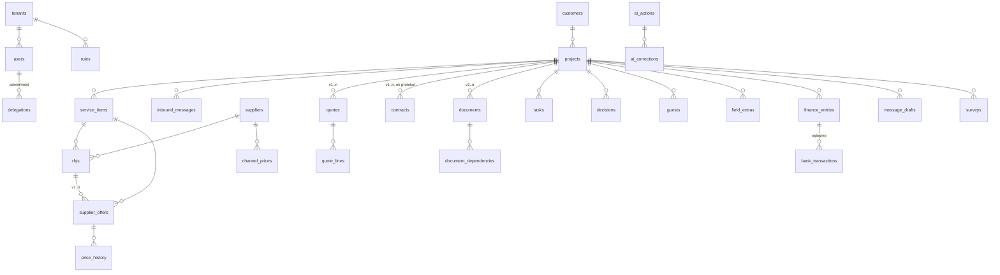

# 02 — Veri Modeli (§19.1)

> PRD karşılığı: §5 (proje/kalem), §8 (veri merkezi, 8 blok), §19.1 (veri modeli), §18.11 (izolasyon testi), §18.13 (değişiklik yayılımı), §18.15 (rıza).
> Kod karşılığı: `packages/shared/src/models.ts` (API'de camelCase; veritabanında snake_case).

## 1. Genel kurallar

| Kural | Uygulama |
|---|---|
| Kimlik | `id uuid PRIMARY KEY DEFAULT gen_random_uuid()` |
| Kiracı | Her tabloda `tenant_id uuid NOT NULL REFERENCES tenants(id)`. Kiracılar arası yabancı anahtarlar (FK) `(tenant_id, id)` bileşik anahtarıyla kurulur, böylece başka acentanın kaydına referans verilemez. |
| Zaman damgası | `created_at timestamptz DEFAULT now()`, `updated_at` (tetikleyiciyle güncellenir) |
| Silme | **Yok.** Bkz. §5. Durum alanları: `cancelled`, `passive`, `superseded`, `ended`, `anonymized_at` |
| Para | `numeric(14,2)` + `currency char(3)`. EUR karşılığı ayrıca `amount_eur` alanında tutulur |
| Enum | `@mice/shared/enums.ts` ile birebir aynı `CHECK` kısıtları kullanılır. Migration testi, iki listenin eşitliğini doğrular |
| Sürüm | Değişebilir iş belgelerinde (teklif, tedarikçi teklifi, sözleşme, belge) eski satır güncellenmez. Yeni satır `version+1` olarak eklenir; eskisi `superseded_by` alanıyla işaretlenir |

## 2. Varlık–ilişki özeti



## 3. Tablolar

Kısaltma: **T** = `tenant_id` var, RLS açık. Tüm tablolarda T vardır, istisnalar ayrıca belirtilmiştir.

### Blok 0 — Kiracı, kullanıcı, yetki

| Tablo | Temel sütunlar | Notlar |
|---|---|---|
| `tenants` | `id, name, slug, branding jsonb (logo, renk, alan adı), locale, data_region, status` | RLS: `id = app.tenant_id`. Kayıt yalnızca platform yöneticisi tarafından açılır |
| `users` | `email (tenant içinde unique), full_name, role, authority_level, authority_scope jsonb, can_sign, languages[], active, password_hash` | `role` ∈ `ROLES`. Yetki seviyesini yalnızca admin değiştirir (tetikleyici, aktörün rolünü kontrol eder) |
| `webauthn_credentials` | `user_id, credential_id bytea unique, public_key bytea, sign_count, transports[], device_label, aaguid, backed_up bool, last_used_at` | Face ID step-up için kullanılır (bkz. 08) |
| `push_subscriptions` | `user_id, endpoint, p256dh, auth, platform, created_at, revoked_at` | Web Push aboneliği |
| `delegations` | `admin_id, delegate_id, starts_at, ends_at, ended_at, reason` | §17.1. Silinmez; `POST /delegations/:id/end` ile sonlandırılır. `EXCLUDE` kısıtı aynı vekil için çakışan aralığı engeller |
| `mail_accounts` | `user_id, provider ('google'|'microsoft'), address, refresh_token_enc bytea, scopes[], watch_expires_at, history_id` | Belirteç uygulama düzeyinde şifreli saklanır |

### Blok 1 — Tedarikçiler

| Tablo | Temel sütunlar | Notlar |
|---|---|---|
| `suppliers` | `name, kinds[], city, district, lat, lng, capacity_pax, room_count, halls jsonb, status, segment, email, phone, contact_name, commission jsonb, payment_terms, performance_score, avg_response_hours, accredited_by, accredited_at` | Yeni kayıt her zaman `candidate` olarak açılır. `accredited`'e geçiş tetikleyicisi şunları doğrular: aktör `user`, rol `admin`, bağlı onaylı `supplier_accreditation` kararı var |
| `supplier_contacts_log` | `supplier_id, channel, direction, summary, at, user_id` | Kontak geçmişi |

### Blok 4 — Müşteriler ve projeler

| Tablo | Temel sütunlar | Notlar |
|---|---|---|
| `customers` | `name, short_code, tax_office, tax_number, billing_address, contacts jsonb, rules jsonb (CustomerRules)` | Yeni müşteri varsayılanı: `firmApproval='signed_or_po'`, `depositRate=0` |
| `projects` | `seq (tenant içinde sıra), code, customer_id, title, event_type, start_date, end_date, pax, rooms_sgl, rooms_dbl, city, district, hall_layout, fnb_needs, technical_needs, transfer_needs, budget, budget_currency, budget_segment, decision_date, billing_info, extraction jsonb, step, outcome, lost_reason, owner_id, venue_name, received_at, quote_sent_at, target_business_days, target_override_reason, customer_wait_minutes, event_ended_at, closed_at` | `seq` acenta bazında `tenant_counters` tablosundan `UPDATE … RETURNING` ile kilitli artırılır. `CHECK (outcome <> 'lost' OR lost_reason IS NOT NULL)` |
| `inbound_messages` | `project_id NULL, channel, from_address, subject, body, provider_message_id, provider_thread_id, received_at, classified_as, classification_confidence` | E-posta ve WhatsApp ham girdisi. `provider_message_id` unique olduğu için çift kayıt oluşmaz |
| `mail_threads` | `provider, provider_thread_id, project_id, linked_by ('code'|'header'|'ai'|'user'), confidence` | Yazışmanın projeye bağlanması (bkz. 07 §6) |
| `service_items` | `project_id, kind, description, date_from, date_to, quantity, unit, nights, specs jsonb, selected_offer_id, value_add, status` | §5 kalem modeli. `value_add=true` ise alış 0'dır |
| `files` | `sha256, storage_key, mime, size, original_name, uploaded_by, source` | Ekler, taramalar, PDF'ler. İçerik nesne deposunda şifreli tutulur |

### Blok 1→2 — RFQ ve teklifler

| Tablo | Temel sütunlar | Notlar |
|---|---|---|
| `rfqs` | `project_id, service_item_id, supplier_id, status, sent_by, sent_at, deadline_at, link_expires_at, reminder_sent_at, call_task_created_at, override_reason, closed_reason` | Bir RFQ = tek kalem × tek tedarikçi (§18.10) |
| `public_tokens` | `token_hash bytea unique (SHA-256), purpose ('rfq'|'quote'|'rooming'|'extra'|'survey'|'consent'), resource_type, resource_id, expires_at, read_only_after, revoked_at, last_used_at, use_count` | Düz token **hiçbir zaman** saklanmaz. Token yalnızca oluşturma yanıtında bir kez döner (`Rfq.supplierLink`) |
| `supplier_offers` | `rfq_id, service_item_id, supplier_id, version, source, currency, lines jsonb (OfferLine[]), option_until, guarantee_pax, attrition_terms, payment_terms, prepayment_rate, cancellation_terms, overtime_terms, notes, confidence, field_confidence jsonb, verified_by, superseded_by, negotiation_round, file_id, ai_action_id` | **Sürümlü.** Revizyon yeni satır olarak eklenir. `UNIQUE(rfq_id, version)` |
| `offer_evaluations` | `offer_id, normalized jsonb, price_class, advantage, benchmark jsonb, suggested_markup, risks[], computed_at, rules_version` | Domain çıktısının anlık görüntüsü. Yeniden hesaplanabilir; denetim için saklanır |
| `price_history` | `supplier_id, kind, city, district, segment, season, service_date, pax, board, room_type, cancellation, unit, initial_price_eur, negotiated_price_eur, realized_price_eur, source_offer_id, project_id, verified bool` | "İyi fiyat" kararının temeli. İlk yükleme yalnızca doğrulanmış kayıtlarla yapılır (`verified=true`) |
| `channel_prices` | `supplier_id, stay_date, room_type, board, cancellation ('flexible'|'non_refundable'), price, currency, price_eur, source (ör. 'booking_affiliate', 'manual'), captured_at, captured_by, evidence_file_id` | Yalnız konaklama. Koşullar birebir eşleşmezse karşılaştırmaya girmez |

### Blok 3→5 — Müşteri teklifi ve sözleşme

| Tablo | Temel sütunlar | Notlar |
|---|---|---|
| `quotes` | `project_id, version, status, currency, fx_rate, fx_source, fx_date, option_until, applied_customer_rules[], block_reasons[], requires_approval, created_by, approved_by, approval_decision_id, sent_at, opened_at, accepted_option_no, accepted_at, accepted_by_name, po_number, margin_override_reason, superseded_by` | `sent` sonrası içerik değişmez; değişiklik yeni sürüm olarak eklenir |
| `quote_lines` | `quote_id, option_no, service_item_id, offer_id, description, kind, quantity, unit, nights, unit_cost_eur, unit_price_eur, markup, vat_rate, value_add, supplier_option_until` | Seçenekler (2–3) `option_no` ile ayrılır |
| `contracts` | `project_id, supplier_id, service_item_ids uuid[], version, template, status, fields jsonb (ContractFields), extraction_confidence, diff jsonb, condition_risk_eur, condition_risk_note, locked, signed_at, signed_by, scan_file_id, amendment_of, superseded_by` | **İmza sonrası kilitlenir.** `locked=true` iken yalnızca `status: signed→amended` ve `superseded_by` güncellenebilir (tetikleyici). Ek protokol yeni satırdır (`amendment_of`) ve Adım 6 değişiklik akışını başlatır |
| `reservations` | `service_item_id, supplier_id, contract_id, confirmation_no, confirmed_at, confirmed_by, status` | Tedarikçi konfirmasyonu. Aktör yalnızca insan olabilir (`supplier_confirmation` AI için yasak) |

### Blok 6 — Belgeler ve bağımlılıklar

| Tablo | Temel sütunlar | Notlar |
|---|---|---|
| `documents` | `project_id, kind, version, status ('current'|'stale'|'pending'), stale_reason, stale_since, content jsonb, content_hash, file_id, generated_at, generated_by, superseded_by` | Belge yeniden üretildiğinde yeni sürüm eklenir; eskisi `superseded` olur |
| `document_dependencies` | `document_id, entity_type, entity_id, entity_version int, entity_hash` | Belgenin üretildiği girdi sürümleri. Bkz. §6 |

### Operasyon, karar, AI

| Tablo | Temel sütunlar | Notlar |
|---|---|---|
| `tasks` | `project_id, assignee_id, kind, title, due_at, status, source ('ai'|'rule'|'user'), origin_key` | `origin_key` (ör. `rfq:<id>:call`) üzerinde unique kısıt vardır; worker idempotent çalışır |
| `decisions` | `project_id, kind, badge, summary, detail jsonb, ai_note, primary_action_label, required_role, requires_biometric, urgent, entity_type, entity_id, draft jsonb, status, decided_by, decided_at, decided_device, via_delegation, webauthn_credential_id, edits jsonb, reason, ai_action_id` | §15 karar kutusu. Onay hareketi kaydı: kim, ne zaman, hangi cihaz, hangi kimlik bilgisi |
| `ai_actions` | `action_type, authority, mode ('approval'|'auto'), model, prompt_version, input_ref, output jsonb, confidence, tokens_in, tokens_out, cost_usd, latency_ms, decision_id, sampled bool, outcome` | Her AI çıktısının kaydı. Otomasyon sayaçlarının ve maliyet raporunun kaynağıdır |
| `ai_corrections` | `ai_action_id, field_path, ai_value jsonb, human_value jsonb, ai_confidence, corrected_by, corrected_at, correction_kind` | Düzeltme = öğrenme verisi (§16.4). Bkz. 04 |
| `automation_counters` | `action_type, mode, consecutive_clean, threshold, sample_rate, promoted_at, promoted_by, demoted_at, demoted_reason, total_auto, total_sampled, sample_errors` | `UNIQUE(tenant_id, action_type)`. Bkz. 06 |
| `automation_events` | `action_type, event ('approved_clean'|'edited'|'rejected'|'sample_ok'|'sample_error'|'error_detected'|'promoted'|'demoted'), ai_action_id, decision_id, at` | Sayaç geçmişi. Sayaç bu olaylardan yeniden hesaplanabilir |
| `message_templates` | `kind, language, version, body, approved_by, approved_at, active` | Önceden onaylı şablonlar. RFQ hatırlatma istisnası bu tabloya bağlıdır |
| `message_drafts` | `project_id, kind, channel, to, subject, body, language, status, from_user_id, ai_generated, ai_action_id, template_id, approved_by, approved_at, sent_at, provider_message_id, original_body` | Gönderimde `original_body` ile `body` farkı üslup öğrenme verisidir |

### Blok 5 — Kurallar ve kontrol listesi

| Tablo | Temel sütunlar | Notlar |
|---|---|---|
| `rules` | `key (RuleKey), value jsonb, version, changed_by, changed_at, reason` | **Kod değil tablo.** Okuma: acenta değeri, yoksa `DEFAULT_RULES`. Yazma yalnızca admin ve `actor_type='user'` ile yapılabilir |
| `rule_suggestions` | `key, proposed_value, evidence jsonb, status, decision_id` | §16.5. AI yalnızca önerir |
| `holidays` | `date, name` | İş takvimi |
| `checklist_questions` | `event_type NULL, question, field, status ('active'|'suggested'|'rejected'), source, decision_id` | §8 Blok 8. Yeni soru admin onayıyla `active` olur |

### Kişisel veri katmanı (KVKK)

| Tablo | Temel sütunlar | Notlar |
|---|---|---|
| `guests` | `project_id, full_name_enc, email_enc, phone_enc, name_bidx, email_bidx, room_type, arrival, departure, consent_reuse, consent_at, consent_text_version, consent_channel, consent_withdrawn_at, retention_until, anonymized_at` | PII alanları **uygulama düzeyinde** AES-256-GCM ile şifrelenir. Her acentanın kendi veri anahtarı (DEK) vardır ve bu anahtar KMS ana anahtarıyla sarılır. `*_bidx`, mükerrer kontrol ve yeniden kullanım için HMAC kör indeksidir. Bu tablo için audit tetikleyicisi değer **yazmaz**, yalnızca değişen alan adlarını yazar |
| `consent_events` | `guest_id, event ('given'|'withdrawn'|'anonymized'), text_version, channel, ip_hash, user_agent, at` | Rıza kanıtı. Yalnızca eklemeye açıktır |
| `consent_texts` | `version, language, body, purpose, approved_by_lawyer_at` | Aydınlatma ve rıza metinleri sürümlüdür |

### Blok 7 — Finans

| Tablo | Temel sütunlar | Notlar |
|---|---|---|
| `finance_entries` | `project_id, service_item_id, supplier_id, kind (FINANCE_KINDS), amount, currency, amount_eur, fx_rate, due_date, status, reference, invoice_no, meta jsonb, contract_id, payment_decision_id, ubl_uuid` | Sözleşme imzasında `payable` ve `receivable` kayıtları otomatik oluşur. `pending_approval → approved` geçişi yalnızca `payment_approval` kararıyla ve biyometrik doğrulamayla yapılır |
| `bank_transactions` | `booked_at, amount, currency, description, counterparty, import_batch_id, row_hash unique, matched_entry_id, match_confidence, status, payer_user_id, escalated_at, last_reminder_at` | Ekstre yüklemede `row_hash` ile mükerrer satır engellenir |
| `field_extras` | `project_id, description, amount_try, entered_by, needs_admin_approval, customer_approved_at, customer_approver_name, customer_approval_channel, reflected_to_customer, not_reflected_reason, offline_client_id unique` | `offline_client_id` çevrimdışı senkronizasyonda idempotensi sağlar |
| `fx_rates` | `date, base, quote, rate, source` | Kur kaynağı ve tarihi |
| `exports` | `kind ('mikro_xlsx'), period_from, period_to, file_id, created_by` | Mikro'ya aktarılan dosyaların izi |

### Blok 8 — Öğrenme ve anket

| Tablo | Temel sütunlar | Notlar |
|---|---|---|
| `surveys` | `project_id, token_id, sent_at, answered_at, q1_score, q2_score, q3_text` | 3 soruluk anket |
| `project_lessons` | `project_id, text, created_by, suggestions_generated_at` | "Neyi geç öğrendik?" |

### Denetim

| Tablo | Temel sütunlar | Notlar |
|---|---|---|
| `audit_log` | `id bigserial, tenant_id, actor_type, actor_id, entity, entity_id, action ('insert'|'update'|'state'), before jsonb, after jsonb, device, request_id, at` | Bölümlenir (partitioned, aylık). `UPDATE` ve `DELETE` hem `REVOKE` ile kapatılır hem tetikleyiciyle reddedilir. İsteğe bağlı olarak her satıra önceki satırın özeti eklenerek hash zinciri kurulur (kurcalama tespiti) |

## 4. RLS kalıbı

Tüm kiracılı tablolara migration aracında tek bir yardımcıyla uygulanır:

```sql
-- Uygulama rolü: tablo sahibi değil, BYPASSRLS yok, DELETE yok.
CREATE ROLE mice_app LOGIN NOINHERIT;          -- migration rolü (mice_owner) ayrı tutulur

ALTER TABLE projects ENABLE ROW LEVEL SECURITY;
ALTER TABLE projects FORCE ROW LEVEL SECURITY;  -- sahip rolüne de uygula

CREATE POLICY tenant_isolation ON projects
  USING      (tenant_id = current_setting('app.tenant_id', true)::uuid)
  WITH CHECK (tenant_id = current_setting('app.tenant_id', true)::uuid);

GRANT SELECT, INSERT, UPDATE ON projects TO mice_app;   -- DELETE verilmez
```

- `current_setting(..., true)` ayar yoksa `NULL` döner. `tenant_id = NULL` hiçbir satırla eşleşmez, yani sistem **kapalı başarısız olur** (fail closed): bağlam unutulursa veri sızmaz, sorgu boş döner.
- Bağlam her işlemde `set_config(..., true)` ile **işlem kapsamında** ayarlanır. Havuzdaki bir bağlantı başka bir acentaya geçtiğinde ayar taşınmaz.
- **Rol bazlı ek politikalar:** `guests` için ikinci bir politika vardır:
  `USING (current_setting('app.role', true) IN ('admin','clerk_ops','field'))`.
  Şifre çözme anahtarı da yalnızca bu rollerin istek yolunda yüklenir.
- **Public token akışı:** Token çözülmeden önce acenta bilinmez. `SECURITY DEFINER` olarak tanımlanan `resolve_public_token(hash bytea)` fonksiyonu yalnızca `(tenant_id, purpose, resource_id, expires_at, read_only)` döner. Ardından normal RLS bağlamı kurulur ve token kapsamı dışındaki hiçbir kaynağa erişilmez.
- **Worker:** Her acenta için ayrı işlem açar ve bağlamı açıkça ayarlar. Acentalar arası tek sorgu yoktur. Platform raporları ayrı bir `mice_platform` rolüyle ve yalnızca toplu, kişisel veri içermeyen görünümlerle çalışır.

## 5. Silinmezlik ve audit tetikleyicileri

```sql
CREATE FUNCTION forbid_delete() RETURNS trigger LANGUAGE plpgsql AS $$
BEGIN RAISE EXCEPTION 'DELETE yasak (%): kayıt durum değişikliğiyle kapatılmalı', TG_TABLE_NAME
  USING ERRCODE = 'insufficient_privilege'; END $$;

CREATE FUNCTION audit_row() RETURNS trigger LANGUAGE plpgsql SECURITY DEFINER AS $$
BEGIN
  INSERT INTO audit_log(tenant_id, actor_type, actor_id, entity, entity_id, action, before, after, device, request_id)
  VALUES (NEW.tenant_id,
          coalesce(current_setting('app.actor_type', true), 'system'),
          current_setting('app.actor_id', true),
          TG_TABLE_NAME, NEW.id::text, lower(TG_OP),
          CASE WHEN TG_OP = 'UPDATE' THEN audit_redact(TG_TABLE_NAME, to_jsonb(OLD)) END,
          audit_redact(TG_TABLE_NAME, to_jsonb(NEW)),
          current_setting('app.device', true),
          current_setting('app.request_id', true));
  RETURN NEW;
END $$;
-- Her iş tablosu için: BEFORE DELETE → forbid_delete ; AFTER INSERT OR UPDATE → audit_row
```

- `audit_redact` fonksiyonu `guests`, `mail_accounts` gibi tablolarda değerleri maskeler. Böylece KVKK anonimleştirmesi audit log içinde kopya bırakmaz.
- **KVKK ile silinmezlik çelişkisinin çözümü:** Anonimleştirme bir `UPDATE` işlemidir. Şifreli alanlar `NULL` yapılır, `anonymized_at` doldurulur. Satır ve iş ilişkileri korunur (oda sayısı, tarih). Bu, "hiçbir kayıt silinmez" ilkesini bozmaz.
- **Durum makinesi tetikleyicileri:** Örnek: `quotes.status` için izinli geçiş tablosu tanımlıdır. `approved` durumuna geçiş için `approval_decision_id` dolu olmalı, karar `approved` durumunda olmalı ve `actor_type='user'` olmalıdır.

## 6. Değişiklik yayılımı: bağımlılık modeli (§18.13)

**İki katmanlı yaklaşım:**

1. **Statik harita** (`domain/propagation.ts` → `DOCUMENT_DEPENDENCIES`, `staleKindsFor`). "Bu alanı değiştirirsem hangi belgeler eskir?" sorusunu düzenleme ekranında **önceden** gösterir.
2. **Kesin kayıt** (`document_dependencies`). Belge üretilirken okunan her varlık `(entity_type, entity_id, entity_version, entity_hash)` olarak yazılır. `entity_hash`, belgenin gerçekten okuduğu alanların kanonik JSON özetidir.

**Tetikleyici akışı:**

```sql
-- service_items, supplier_offers, quotes, contracts, projects, customers, finance_entries, guests, field_extras
CREATE FUNCTION propagate_staleness() RETURNS trigger LANGUAGE plpgsql AS $$
BEGIN
  UPDATE documents d SET status = 'stale',
         stale_reason = format('%s %s değişti', TG_TABLE_NAME, NEW.id), stale_since = now()
  WHERE d.status = 'current'
    AND d.superseded_by IS NULL
    AND EXISTS (SELECT 1 FROM document_dependencies dd
                WHERE dd.document_id = d.id AND dd.entity_type = TG_TABLE_NAME AND dd.entity_id = NEW.id);
  RETURN NEW;
END $$;
```

- **Gürültü filtresi:** Tetikleyici `WHEN (OLD.* IS DISTINCT FROM NEW.*)` koşuluyla çalışır. Yalnızca `updated_at` gibi teknik alanlar değiştiyse belge eskimez. Alan bazlı hassasiyet için API katmanı `staleKindsFor(entity, changedFields)` sonucunu kullanır.
- **Gönderim kilidi:** `POST /quotes/:id/send`, `/contracts/:id/sign` ve taslak gönderimi bağlı belgenin `status='current'` olduğunu ve dependency hash'lerinin güncel değerlerle eşleştiğini kontrol eder (çift kontrol). Aksi halde `409 DOCUMENT_STALE` döner.
- **Yeniden üretim:** "Yeniden üret" eylemi yeni sürüm ekler. Değişiklik özeti (`changeImpact`) karar kartında gösterilir. Marj eşiğin altına düşerse `margin_override` kararı açılır.
- **Neden yalnızca kod ya da yalnızca tetikleyici değil?** Kod tarafı tetikleyiciyi atlayan yollarda (toplu import, elle SQL düzeltmesi) yetersiz kalır. Tetikleyici tarafı ise alan semantiğini bilmez. İki katman birlikte hem güvence hem kullanılabilirlik sağlar.

## 7. İzolasyon test stratejisi (§18.11)

"Bir acentanın verisinin diğerine sızmadığının kanıtı", CI'da her commit'te çalışan şu katmanlardan oluşur:

| # | Test | Nasıl | Kanıtladığı |
|---|---|---|---|
| 1 | **Katalog testi** | `pg_class` / `pg_policies` sorgusu: `tenant_id` sütunu olan her tabloda `relrowsecurity` ve `relforcerowsecurity` açık mı, `tenant_isolation` politikası var mı? `mice_app` rolünde `BYPASSRLS` ve `DELETE` yetkisi yok mu? | Yeni eklenen bir tablo politikasız kalamaz (CI kırılır) |
| 2 | **SQL düzeyi çapraz okuma/yazma** | İki acenta (A, B) fixture'ı kurulur. Her tablo için bağlam A iken: B satırlarını `SELECT` → 0 satır; B'nin `tenant_id` değeriyle `INSERT` → hata; B satırına `UPDATE` → 0 satır | Politika hem okumada hem yazmada doğru |
| 3 | **Bağlamsız sorgu** | `app.tenant_id` ayarlanmadan her tabloda `SELECT count(*)` → 0 | Kapalı başarısızlık |
| 4 | **API çapraz kimlik testi** | Rota listesinden otomatik üretilir: A kullanıcısının token'ı ile B'ye ait her `:id` için tüm `GET/PATCH/POST` çağrıları → `404`. Yanıt gövdesinde B'ye ait hiçbir kimlik (UUID taraması) bulunmamalı | Uygulama katmanı sızıntısı yok |
| 5 | **Public token kapsamı** | A'nın RFQ token'ı ile başka kalem/tedarikçi/proje erişimi; süresi dolmuş, iptal edilmiş ve salt-okunur token ile yazma denemesi | Token tek kaynağa bağlı |
| 6 | **Havuz eşzamanlılık testi** | Aynı havuz üzerinde A ve B için 1.000 eşzamanlı, rastgele sıralı istek. Her yanıtın yalnızca kendi acentasının verisini içerdiği doğrulanır | `SET LOCAL` bağlamı bağlantılar arasında taşınmıyor |
| 7 | **Worker testi** | Takip işçisi A ve B için çalışır. Oluşan görev, karar ve mesajların `tenant_id` değeri kaynak kayıtla aynı olmalı | Arka plan işleri izole |
| 8 | **AI bağlam testi** | `ask()` ve taslak üretiminde modele giden istem kaydedilir (mock). İstemde başka acentanın kimlik, ad veya tutarı bulunmamalı | Yapay zekâ yalnızca izinli veriyi görüyor (§6) |
| 9 | **Özellik tabanlı (property-based) test** | fast-check ile rastgele varlık grafikleri ve rastgele aktör/acenta kombinasyonları üretilir. Değişmez kural: görünen her satırın `tenant_id` değeri aktörün acentasına eşit | Elle yazılmayan kenar durumlar |
| 10 | **Dış sızma testi** | SaaS açılışından (Faz 3) önce bağımsız pentest yapılır. Kapsam: IDOR, token, RLS bypass | Bağımsız doğrulama |

Test çıktısı her sürümde **"İzolasyon raporu"** olarak saklanır: tablo sayısı, politika kapsamı, çalıştırılan senaryo sayısı. Bu rapor SaaS satışında müşteriye gösterilebilecek kanıttır.
