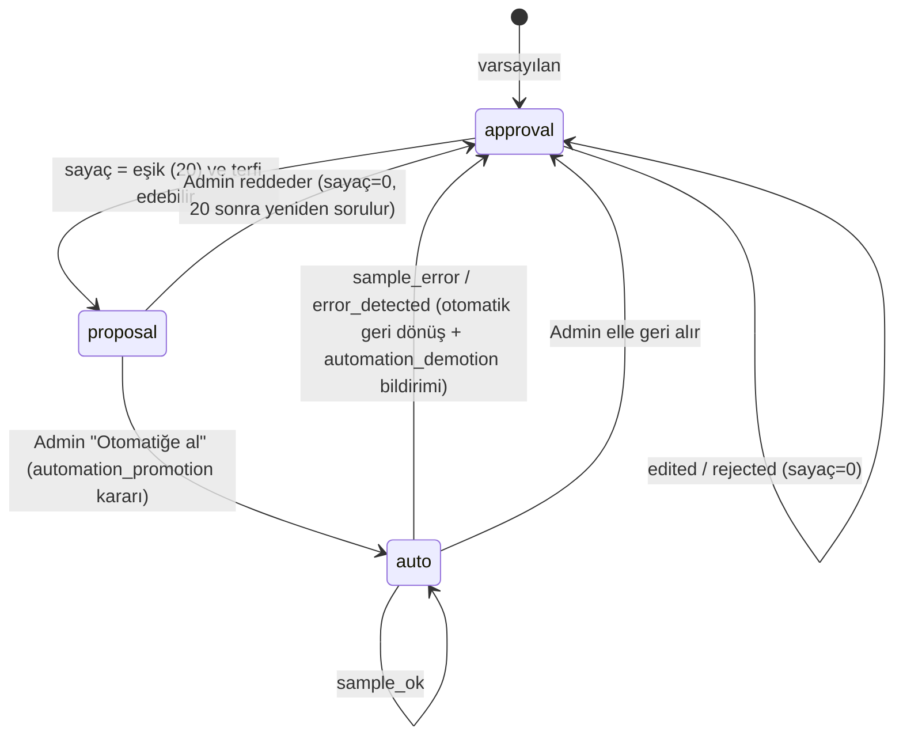

# 06 — Otomasyon Terfi Mekanizması (§19.5, §18.12)

> PRD karşılığı: §16.1–16.4 (terfi, örneklem denetimi, otomatik geri dönüş, düzeltme = geri bildirim), §14 (otomasyon kayması).
> Kod karşılığı: `AutomationCounter` (`models.ts`), `domain/automation.ts` (`applyAutomationOutcome`, `shouldSample`, `promote`), `isPromotable` (`ai-authority.ts`), kurallar `automationPromotionThreshold = 20`, `automationSampleRate = 0.05` (yani 1/20).

## 1. Kapsam: hangi işlemler terfi edebilir?

| Seviye | Terfi | Gerekçe |
|---|---|---|
| `autonomous` | Uygulanmaz | Zaten onaysızdır |
| `suggest` | **Evet** (`isPromotable`) | §16.1 |
| `forbidden` | **Asla** | §16.1. Ek olarak `promote()` fonksiyonu yasak işlem için istisna fırlatır; veritabanında `CHECK` kısıtı vardır |

Önerilen ek sınırlamalar [Ürün kararı]:

- `checklist_new_question` terfi etmez; kural niteliğindedir ve admin'e özeldir.
- `customer_quote` yalnızca "kural içindeki" teklifler için ve kişi bazlı yetki seviyesiyle birlikte terfi edebilir (bkz. §5).

## 2. Durum makinesi



**Sayaç kuralları** (`applyAutomationOutcome`):

| Olay | Onay modunda | Otomatik modda |
|---|---|---|
| `approved_clean` (karar kartında "Onayla", düzeltme yok) | `consecutiveClean + 1`. Eşiğe ulaşılırsa `proposePromotion = true` | — |
| `edited` ("Düzelt" ile değiştirilerek onaylandı) | `consecutiveClean = 0` | — |
| `rejected` | `consecutiveClean = 0` | — |
| `sample_ok` | — | `totalSampled + 1` |
| `sample_error` (örneklemde admin düzeltti/reddetti) | — | **Geri dönüş:** `mode = 'approval'`, `consecutiveClean = 0`, `demotedAt`, `sampleErrors + 1` |
| `error_detected` (örneklem dışında, sonradan tespit edilen hata) | `consecutiveClean = 0` | **Geri dönüş** |

**"Hata tespit edildi" ne demek?** Otomatik yapılmış bir işlemin çıktısının sonradan insan tarafından düzeltilmesi (`ai_corrections` kaydı) veya ilgili kaydın iptali, revizyonu ya da şikâyete bağlanması. Örnekler: müşteri eksik bilgi sorusuna "bunu zaten yazmıştım" dedi; tedarikçi RFQ'daki tarihin yanlış olduğunu bildirdi. Tespit yolları:

- Taslak, eşleşme veya kayıt üzerinde sonradan yapılan düzeltme otomatik olarak `error_detected` üretir.
- Her otomatik işlem kartının detayında "Bu otomatik işlem hatalıydı" bağlantısı bulunur (tek tık).

## 3. Veri modeli

```sql
CREATE TABLE automation_counters (
  id uuid PRIMARY KEY DEFAULT gen_random_uuid(),
  tenant_id uuid NOT NULL REFERENCES tenants(id),
  action_type text NOT NULL,                          -- AiActionType
  mode text NOT NULL DEFAULT 'approval' CHECK (mode IN ('approval','auto')),
  consecutive_clean int NOT NULL DEFAULT 0,
  threshold int NOT NULL,                             -- rules.automationPromotionThreshold (20)
  sample_rate numeric(4,3) NOT NULL,                  -- rules.automationSampleRate (0.05)
  promoted_at timestamptz, promoted_by uuid,
  demoted_at timestamptz, demoted_reason text,
  proposal_decision_id uuid,                          -- açık terfi önerisi kartı
  total_auto int NOT NULL DEFAULT 0,
  total_sampled int NOT NULL DEFAULT 0,
  sample_errors int NOT NULL DEFAULT 0,
  UNIQUE (tenant_id, action_type),
  CHECK (action_type NOT IN ('money_movement','supplier_confirmation','contract_signature',
         'supplier_accreditation','rule_change','record_deletion','external_message_unapproved'))
);

CREATE TABLE automation_events (                      -- değişmez olay günlüğü; sayaç bundan yeniden kurulabilir
  id bigserial PRIMARY KEY, tenant_id uuid NOT NULL, action_type text NOT NULL,
  event text NOT NULL CHECK (event IN ('approved_clean','edited','rejected','sample_ok','sample_error',
                                       'error_detected','promoted','demoted','proposal_rejected')),
  ai_action_id uuid, decision_id uuid, actor_id uuid, at timestamptz NOT NULL DEFAULT now()
);
```

- `ai_actions.mode` ve `ai_actions.sampled` alanları her işlemin hangi modda yapıldığını ve örnekleme seçilip seçilmediğini saklar.
- **Eşzamanlılık:** Sayaç güncellemesi `SELECT … FOR UPDATE` ile yapılır. Olay günlüğü kaynak, sayaç ise önbellektir. Gece çalışan doğrulama işi ikisini karşılaştırır.
- `mode` değişikliği (`approval → auto`) bir kural değişikliğidir. Bu nedenle aktör kullanıcı ve rol admin olmalıdır; vekil yapamaz (`ADMIN_ONLY_DECISIONS` içinde `automation_promotion`). Geri dönüş (`auto → approval`) ise **güvenli yöndedir**: sistem kendiliğinden yapabilir (§16.3).

## 4. Çalışma akışı

### Onay modunda

1. AI işlemi üretir ve `decisions` kaydı açar (ör. `rfq_send`).
2. Kullanıcı karar verir. `POST /decisions/:id/decide` uç noktası `DecisionInput.action` değerine göre olayı belirler: `approve` ve `edits` yok ise `approved_clean`; `edit` ise `edited`; `reject` ise `rejected`.
3. `applyAutomationOutcome` çalışır. `proposePromotion` true ise admin'e `automation_promotion` kartı açılır.

### Otomatik modda

1. AI işlemi üretir. Önce domain kuralları çalışır (ör. `validateQuote`, `negotiationDraftViolations`). **Kural ihlali veya güven eşiği altı varsa otomatik mod uygulanmaz; işlem normal onaya düşer.** Otomasyon yalnızca "temiz" durumları kapsar.
2. `shouldSample(sampleRate, rng)` çağrılır. Rastgele sayı kriptografik kaynaktan (`crypto.randomInt`) alınır ve seçim `ai_actions.sampled` alanına kaydedilir.
3. **Dış mesaj içeren işlemler** (`rfq_send`, `negotiation_message`, `customer_missing_info_question`, `option_extension_request`, `revision_request`, `customer_quote`):
   - **Örneklem seçildiyse:** Mesaj **gönderilmeden** bekletilir ve `audit_sample` kartı açılır (ön-denetim). Kart 4 iş saati içinde karara bağlanmazsa normal onay kartına dönüşür. Mesaj hiçbir durumda onaysız gitmez.
   - **Seçilmediyse:** Mesaj sorumlu kullanıcının adresinden gider. Taslakta `approved_by = promoted_by` (terfiyi onaylayan admin) ve `approval_basis = 'standing_automation'` kaydedilir.
4. **İç işlemler** (`team_assignment`, `margin_suggestion`, `low_confidence_payment_match`): İşlem uygulanır. Örneklem seçildiyse `audit_sample` kartı sonradan denetim için açılır (son-denetim).

> **İnsan imzası ilkesiyle uyum (§3.3) [Ürün kararı]:** Dış mesajın otomatik gönderimi, admin'in iş türü bazında verdiği **kalıcı onaya** dayanır. Bu onay kayıtlıdır ve geri alınabilir. Gönderim yine kişinin kendi adresinden yapılır. Acenta bu yorumu kabul etmezse dış mesaj işlemleri `isPromotable` dışına alınabilir; bu durumda terfi yalnızca iç işlemlerde ve taslağın "tek tık onaya" indirgenmesinde kullanılır. Bu konu açık bir karar olarak yönetimde onaylanmalıdır.

## 5. `customer_quote` ve kişi bazlı yetki

PRD iki ayrı mekanizma tanımlar. Teknik olarak ayrı tutulmaları önerilir:

| Mekanizma | Neyi otomatikleştirir | Kim değiştirir |
|---|---|---|
| Kişi bazlı yetki (§4) | **Kişinin** teklifinin admin onayına gelip gelmediği | Yalnızca admin, elle (sistem kimseyi terfi ettirmez) |
| Otomasyon terfisi (§16) | **AI'nin hazırladığı** teklif taslağının, kural içindeyse kişinin onayına bile gelmeden hazır olması | Admin, terfi kartıyla |

Teklifin müşteriye gönderimi her durumda bir insanın "Gönder" eylemiyle olur (önerilen). Böylece §4'teki "sistem kimseyi otomatik terfi ettirmez" kuralı korunur.

## 6. Arayüz

| Ekran | İçerik |
|---|---|
| **Karar kartı: `automation_promotion`** | Başlık "Artık otomatik yapayım mı?". Özet: "RFQ gönderimi — son 20 öneri düzeltmesiz onaylandı." Detay: son 20 örneğin listesi, ortalama onay süresi, son düzeltmeden bu yana geçen süre. Birincil eylem: "Otomatiğe al". Diğer eylemler: Reddet. Düzelt yok (eşik veya örneklem oranı ayarı ayrı ekrandadır) |
| **Karar kartı: `audit_sample`** | Rozet "öneri". "Otomatik yapılan bu RFQ'yu kontrol eder misin?" Ön-denetimde mesaj taslağı düzenlenebilir. Eylemler: Doğru (`sample_ok`), Düzelt ve Reddet (her ikisi `sample_error` ve geri dönüş üretir) |
| **Bildirim: `automation_demotion`** | Rozet "kritik". "Pazarlık mesajı otomasyonu durduruldu: örneklemde hata bulundu. Yeniden onay moduna döndü." Hata kaydına bağlantı içerir. Tek eylem: "Gördüm" |
| **Ayarlar → Otomasyon** (`GET /api/automation`) | İş türü tablosu: mod (rozet), sayaç ilerlemesi (ör. 14/20 çubuğu), toplam otomatik, örneklem sayısı, örneklem hatası, son terfi/geri dönüş tarihi. Admin için "Onay moduna al" düğmesi bulunur. Yasak işlemler gri ve kilit simgeli listelenir: "Bu işlem hiçbir koşulda otomatiğe geçemez" |
| **Haftalık rapor** (`WeeklyReport.automation`) | `autoCount`, `sampled`, `sampleErrors`, `demotions` |

## 7. Test senaryoları (domain birim testleri)

1. 19 `approved_clean` olayında öneri yoktur; 20.'de `proposePromotion = true`.
2. 15 temiz onaydan sonra 1 `edited` gelirse sayaç 0'lanır.
3. `forbidden` işlem 1.000 temiz onaydan sonra da öneri üretmez; `promote()` istisna fırlatır.
4. Otomatik modda `sample_error` geldiğinde `mode = 'approval'`, `consecutiveClean = 0` ve `demoted = true` olur.
5. `shouldSample(0.05, rng)` için sabit tohumlu 100.000 denemede oran 0,05 ± 0,003 aralığındadır; `rng = 0.049` → true, `rng = 0.05` → false.
6. Otomatik modda, ancak güven eşiği altı veya kural ihlali olan işlem onaya düşer ve sayaçta otomatik işlem olarak sayılmaz.
